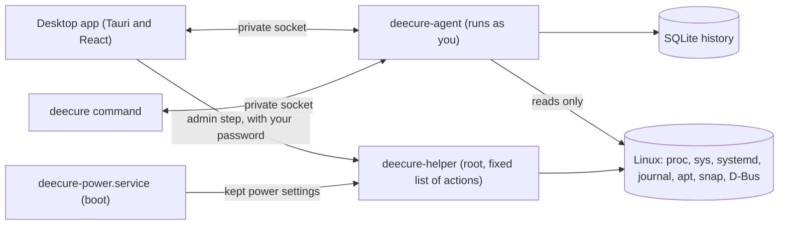

# DeeCure: deep insight into every layer of your Linux computer

**Deep insight into every layer of a Linux computer: sensor limits, PCIe links, firmware, kernel settings, and services. Warns on the hardware's own limits and fixes problems safely.** Free, open source, and private: everything stays on your computer.

[](https://github.com/krisskad0/DeeCure/actions/workflows/ci.yml)
[](LICENSE)


[](https://github.com/krisskad0/DeeCure/releases)
[](https://securityscorecards.dev/viewer/?uri=github.com/krisskad0/DeeCure)

> **In one sentence:** DeeCure reads what your computer knows about itself, from each sensor's own limit to the file that set each kernel setting, explains it, warns when something can harm the machine, and fixes it with a preview and undo.

**Install on Ubuntu 24.04 or 26.04** (open the Terminal with `Ctrl` + `Alt` + `T`):

```bash
curl -fsSL https://raw.githubusercontent.com/krisskad0/DeeCure/main/packaging/install.sh | sudo sh
```

Then open **DeeCure** from the app menu. [All install options](docs/07-user-guide/install.md)

---

## What DeeCure shows you

Things that normally take many commands, or are not shown anywhere at all:

- A drive running on a **slower PCIe link** than both the drive and its slot support.
- The **temperature limits your CPU and NVMe drive report themselves**, and how long they stayed near them.
- **Which app keeps the second graphics card awake**, draining the battery.
- **Which device woke the laptop** from sleep, and every device allowed to.
- **Which config file set each kernel setting**, and whether a later file overrides it.
- Whether **automatic security updates really installed**, and why not ("stopped: metered connection").
- What a **USB-C charger offers** against what the laptop accepts.
- What really **delayed the boot**: the critical chain, step by step.
- **Real memory per app** (PSS and USS), not the misleading total.
- How locked down **each service** is (systemd's exposure score), and what it costs in CPU, memory, and disk.
- A **USB 3 device stuck at USB 2 speed**, and the firmware security level (HSI) with every check behind it.
- **Every installed file checked** against its package, every screen read from its own EDID, every CPU security flaw with its state.

62 kinds of live data, 22 pages and 78 tabs, each with real data from your computer.

## Contents

- [What DeeCure shows you](#what-deecure-shows-you)
- [What is DeeCure?](#what-is-deecure)
- [Why one app instead of ten tools](#why-one-app-instead-of-ten-tools)
- [Features](#features)
- [Three view levels: Beginner, Advanced, Expert](#three-view-levels-beginner-advanced-expert)
- [How it works](#how-it-works)
- [Safety and privacy](#safety-and-privacy)
- [Command line](#command-line)
- [FAQ](#faq)
- [Roadmap](#roadmap)
- [Build from source](#build-from-source)
- [Documentation](#documentation)
- [Contributing, security, license](#contributing)

## What is DeeCure?

Your Linux computer knows a great deal about itself: every sensor's limit, every battery cell, every drive's link, every wake-up source, every service's sandbox, every change. That knowledge is spread over `/proc`, `/sys`, systemd, the journal, apt, snap, D-Bus, firmware, and dozens of commands. DeeCure reads all of it, connects it, and turns it into answers:

1. **Understand:** a deep view of the whole machine: CPU, memory, disks, graphics, battery, sensors, firmware, USB and PCIe, network, services, packages, containers, security, and what changed.
2. **Keep it healthy:** 53 health warnings that use each part's **own** limits (the CPU's own critical temperature, the drive's own warning temperature) and fire only when a problem lasts.
3. **Warn early:** a disk that keeps filling, a battery that gets too hot while charging, cooling that cannot keep up, memory errors, disk read errors, automatic security updates that silently stopped.
4. **Fix safely:** 45 fixes with a preview of every step, your password only for admin steps, a check afterwards, and undo.
5. **Control:** battery charge limits, CPU turbo and speed on battery, sleep and wake-up, lid action, device power saving, all kept after restart.

It is for anyone who wants **full control of their own computer**: experts who want every detail, and beginners who want it explained (the Beginner view keeps it short).

## Why one app instead of ten tools

Getting this picture today means a dozen tools and commands (`lspci -vv`, `sensors`, `smartctl`, `systemd-analyze`, `journalctl`, `upower`, `powertop`, `sysctl`, `debsums`, and forum searching), and none of them connects one finding to another. DeeCure does:

| You want to… | DeeCure |
| --- | --- |
| Know why the PC is slow | Names the cause in 10 seconds (CPU, memory, disk, or heat) and the app behind it, with memory and disk stall readings |
| Free disk space | Shows what uses it, predicts **when the disk is full** (only from real, lasting growth), and cleans each part with one click |
| Protect the battery | Charge limits (such as 80%), charge mode, battery health and temperature, and a warning when the charger is too weak |
| Stop overheating | Each part's own temperature limits, heat slowdowns, fan checks, and what to do |
| Save power | Turbo, highest CPU speed on battery, PCIe power saving, device power saving, Wi-Fi power saving, deep sleep, wake-up sources |
| Find out what broke | A timeline of every package, kernel, config file, device, crash, and hardware error, with line-by-line config diffs |
| Stay secure | Updates (and whether automatic updates really install), firewall, open ports, AppArmor, Secure Boot, CPU security flaws |
| Understand a name | 136 plain-English explanations of services, ports, log errors, and how-tos, right where they appear |

## Features

### Health warnings that respect how you use your computer

- **Harm, not use:** a CPU at 100%, RAM full of cache, swap in use, or a busy disk never warns. Stalls, errors, heat, wear, and risk do.
- **The hardware's own limits:** temperatures are judged against the limit each CPU, drive, graphics card, and Wi-Fi chip reports, not one number for every computer.
- **No false alarms from spikes:** most warnings need the problem to last (for example 5 minutes near the limit).
- **Your limits:** turn any warning off, or change when it fires, in Settings. DeeCure's default is shown next to your value, and every value stays inside a safe range.
- **53 warnings** across CPU, memory, disks and filesystems, battery, temperatures and fans, graphics, hardware errors, the kernel, services, the clock, packages, network, and security. Full list: [Health warnings](docs/01-product/health-warnings.md).

### Deep view of the whole computer (Expert)

- **CPU:** speed per core, power limits, caches, microcode, CPU security flaws, sleep states, heat slowdowns, interrupts.
- **Memory:** where every byte goes, real memory per app and service (PSS, USS), swap and compressed swap, out-of-memory scores, memory error counters per module.
- **Drives:** NVMe and SATA details, PCIe link speed against what the drive and slot support, TRIM, scheduler, partition alignment, filesystem errors, disk use per app and service.
- **Graphics:** clocks, power, which app keeps a second card awake, video decoding in hardware, the driver stack.
- **Battery and power:** voltage, current, temperature, health, charge limits and modes, USB-C Power Delivery offers, chargers, every wake-up source.
- **Firmware and ports:** firmware security level (HSI), Secure Boot, TPM, Thunderbolt, UEFI boot entries, the USB tree with real speeds, USB-C ports.
- **Devices:** cameras, fingerprint readers, screens read from their own EDID (size, refresh, HDR), sound cards, network chips.
- **System:** boot critical chain, every service's cost and sandboxing score, kernel settings and who set them, loaded modules, DKMS drivers, time sync.
- **Software:** packages, snaps (with old versions), Flatpak runtimes, package health, and a full check of every installed file against its package.

### Optimize: only what your computer measurably needs

A page of improvements, each offered **only when a measurement on this computer shows it is needed**, with its numbers. Examples: free space parts over their limit, unused packages, a log size cap, the file-watch limit, a better hard disk scheduler, compressed swap when swapping stays high, a charge limit when the laptop is on mains most of 14 days, turbo off on battery when heat slows it, the hardware video driver, a second graphics card that stays awake, firmware updates, missing DKMS builds. Common "speed-up tips" that do not help on Ubuntu are never offered, and the page says why. [Optimize catalog](docs/01-product/optimize-catalog.md)

### Power and battery controls

Battery charge limits (presets or your own), charge mode, CPU turbo, highest CPU speed on battery (set again each time you plug in or unplug), PCIe power saving, suspend type, what closing the lid does, device wake-up and power saving, keyboard backlight, radios, Wi-Fi power saving. Risky ones (PCIe power saving, deep suspend) are tried for this session first and kept only when you press **Keep**. Kept settings are set again at every start, and skipped when a different device is in that place.

### Safe fixes with undo

45 fixes. Each shows its exact steps and commands first; untick any step; admin steps ask for your password through the normal Ubuntu dialog; DeeCure checks that it worked and keeps an undo for every step that can be undone. Steps that cannot be undone say so before you apply them.

### What changed, predictions, notifications

- **Timeline:** package installs and upgrades (apt, dpkg, snap, Flatpak), config changes with diffs, USB devices, boots, unclean shutdowns, crashes, apps stopped for memory, and hardware errors from the kernel log.
- **Disk forecast:** "full in about N days", only when the disk keeps filling over both the last day and the last 3 days, so one big install never causes a false alarm.
- **Notifications:** critical problems right away, quiet hours, never the same alert twice in 24 hours, and a weekly summary with your health trend.

### Updates that check themselves

DeeCure looks for a new release daily (or weekly, or never), tells you once, and installs it after your OK, or automatically if you choose. Before apt installs anything, every package is checked against the release's checksums and its own name, version, and architecture, and only a newer version is accepted. [How updates work](docs/02-architecture/updates.md)

## Three view levels: Beginner, Advanced, Expert

- **Beginner** (default): a short menu of 8 pages in plain words. Light and calm.
- **Advanced:** every page: logs, services, scheduled jobs, containers, network, accounts, and more.
- **Expert:** every page, plus the deep data above, data sources, exact commands, raw columns, and the Optimize page.

22 pages and 78 tabs in all, every one with real data from your computer. [View levels](docs/01-product/view-levels.md)

## How it works



1. **The agent** runs in the background as your normal user. Every minute it reads the system, keeps a compact history (2 years in under 200 MB), and checks 53 rules that turn readings into findings. Deep data is read only while its page is open.
2. **The desktop app and the `deecure` command** ask the agent over a private Unix socket only your user can open.
3. **Admin steps** go to a small **root helper** that knows a fixed list of actions (31, each with its own polkit prompt), checks every input against the live system, runs no shell, and writes an audit log. It starts only when needed and exits after 2 idle minutes.
4. **Kept power settings** are set again at boot by a small service, with the same checks.

Measured on a real laptop: about **0.1% CPU** when idle, about **21 MB** of memory, first results in under a second. [Architecture](docs/02-architecture/overview.md)

## Safety and privacy

- **Private by design:** no account, no telemetry, no cloud. Nothing about your computer leaves it. The one connection is the update check (daily by default, or weekly, or never), which only asks GitHub for DeeCure's release list.
- **Read-only by default:** about 80% of everything works without a password.
- **Honest data:** a value DeeCure cannot read is shown as unknown, never guessed. Warnings never act on stale or missing data.
- **No surprises:** DeeCure never restarts services it does not have to (for example, the lid setting waits for the next restart instead of ending your session).
- **Supply-chain safety:** signed build provenance and an SBOM on releases, CI actions pinned to exact commits, dependency and license checks, CodeQL scanning ([SECURITY.md](SECURITY.md)).
- **Well tested:** 375 Rust tests and 198 UI tests, randomized hostile input against the root helper, replays of real machines' `/proc` and `/sys`, every page rendered with real data, container tests of the `.deb` packages, an end-to-end helper test with real D-Bus and polkit, and a performance budget checked on every push.

## Command line

Everything works in the terminal too, also on servers without a desktop:

```bash
deecure status                    # health score and problems, in plain English
deecure history --since 2d        # what changed in the last 2 days
deecure report --html report.html # a 7-day report to share
deecure fix --list                # every fix
deecure fix storage.free_space    # preview a fix, then run it after you say yes
deecure undo 12                   # take a fix back
```

Add `--json` for scripts. [User guide](docs/07-user-guide/using-deecure.md)

## FAQ

**What is DeeCure?** Free, open-source software that gives deep insight into every layer of a Linux computer (sensors and their own limits, PCIe links, firmware, the kernel, services, packages), warns on the hardware's own limits, controls battery and power settings, and fixes problems safely with undo, in one desktop app and one command.

**Is it a replacement for GNOME System Monitor or htop?** It shows what they show (processes, CPU, memory, disks, network), and goes much deeper: each part's own limits, PCIe and USB link speeds, firmware security, kernel settings and their source files, service sandboxing, real memory per app, what changed, and warnings and fixes built on all of that.

**Does it send my data anywhere?** No. There is no account, no telemetry, and no cloud. The only connection is the update check, which asks GitHub for DeeCure's release list and sends nothing about your computer; set it to Never in Settings › About to stay fully offline.

**How does DeeCure update itself?** It checks GitHub daily (or weekly, or never) and tells you when a new version is out. Install it from Settings › About with your password, or let it install automatically. Either way, every package is checked against the release's checksums and its own name and version before apt installs it.

**Does it need root?** No, not to look. Your password is asked only for admin fixes and admin read-outs, each time, through the standard Ubuntu dialog.

**Will it slow my computer down?** No. The agent uses about 0.1% CPU when idle and about 21 MB of memory, and deep data is read only while you look at it.

**Can a fix break my system?** Every fix shows its exact steps first, lets you untick any step, checks the result, and keeps an undo when the step can be undone. Risky power settings are tried for one session before they are kept.

**Will it warn me all the time?** No. Normal use (a busy CPU, full RAM cache) never warns, short spikes never warn, and you can turn any warning off or change its limit.

**Can I set a battery charge limit on Linux with it?** Yes, when the laptop supports it (many Dell, Lenovo, ASUS, and others): presets such as 80%, or your own start and stop values, kept after restart.

**Which Linux versions are supported?** Ubuntu 24.04 LTS and 26.04 LTS first. Debian, Fedora, Arch, and KDE are planned.

## Roadmap

| Phase | What | State |
| --- | --- | --- |
| 0-1 | Agent, history, rules, desktop app with real data on every page | Built |
| 2 | Safe fixes, root helper, undo, signed APT repository | Built; real-machine test matrix and security review pending |
| 3 | What-changed timeline, predictions, notifications, weekly report, tray icon | Built |
| Expert build | Three view levels, deep hardware and system data, power controls kept after restart, Optimize, 53 health warnings with your own limits | Built; admin read-outs (BIOS settings, memory slots, drive wear, power meters) next |
| 4 | "Ask DeeCure": a private, local AI that answers questions with sources | Planned |
| 5 | More distros, KDE, server mode, many PCs | Planned |

The newest pre-release is [v0.1.0-alpha.3](https://github.com/krisskad0/DeeCure/releases). Details: [roadmap](docs/05-roadmap/README.md) and [what is left](docs/05-roadmap/pending.md).

## Build from source

On Ubuntu 24.04 or newer, with Rust, Node.js 22, and a few system libraries ([getting started](docs/04-development/getting-started.md)):

```bash
git clone https://github.com/krisskad0/DeeCure.git
cd DeeCure
make agent        # terminal 1: start the background agent
make app          # terminal 2: start the desktop app
```

## Documentation

Start at [docs/README.md](docs/README.md).

| Folder | What's inside |
| --- | --- |
| [01-product](docs/01-product/README.md) | Vision, view levels, Expert coverage, health warnings, Optimize, user journey |
| [02-architecture](docs/02-architecture/README.md) | Agent, collectors, rules, fixes, root helper, storage, security |
| [03-ui-design](docs/03-ui-design/README.md) | Design tokens, shell, components, pages |
| [04-development](docs/04-development/README.md) | Setup, repo layout, writing rules, testing |
| [05-roadmap](docs/05-roadmap/README.md) | Phase-by-phase plan and the pending list |
| [06-packaging](docs/06-packaging/README.md) | `.deb` packages, APT repository, releases |
| [07-user-guide](docs/07-user-guide/README.md) | Install and everyday use |
| [08-contributing](docs/08-contributing/README.md) | Issues, pull requests, reviews |

Built with Rust (agent, root helper, CLI, fix runner), Tauri v2 + React + TypeScript (desktop app), SQLite, zbus (D-Bus), polkit, and YAML rules and knowledge base. Repository layout: [project structure](docs/04-development/project-structure.md).

## Contributing

You can help without writing Rust: add checks and plain-English explanations in YAML, share test data from your laptop, or improve the docs. See [CONTRIBUTING.md](CONTRIBUTING.md).

## Security

Please report security problems privately. See [SECURITY.md](SECURITY.md).

## License

[Apache License 2.0](LICENSE). Free to use, change, and share.

---

*Keywords: Linux control center, Linux system monitor, Ubuntu health check, hardware monitor for Linux, CPU temperature monitor Linux, battery health Linux, battery charge limit Ubuntu, laptop power management Linux, Linux optimizer, disk space cleanup Ubuntu, why is my Linux PC slow, Linux overheating, SSD health Linux, failed systemd services, Linux security check, what changed after update, Ubuntu maintenance tool, PC doctor for Linux, TLP alternative, GNOME System Monitor alternative.*
