# DeeCure: Linux system monitor, health check, and optimizer for Ubuntu

**DeeCure is a free, open-source app that checks the health of your Linux computer, explains what it finds in plain English, warns you before something breaks, and fixes problems safely with undo.** It covers your CPU, graphics, memory, disks and SSDs, battery, temperatures, firmware, services, updates, and security, in one desktop app and one terminal command. Everything stays on your computer: no account, no cloud, no telemetry.

[](https://github.com/krisskad0/DeeCure/actions/workflows/ci.yml)
[](LICENSE)


[](https://github.com/krisskad0/DeeCure/releases)
[](https://securityscorecards.dev/viewer/?uri=github.com/krisskad0/DeeCure)

<picture>
  <source media="(prefers-color-scheme: dark)" srcset="docs/07-user-guide/images/deecure-expert-overview-health-dashboard-dark.png">
  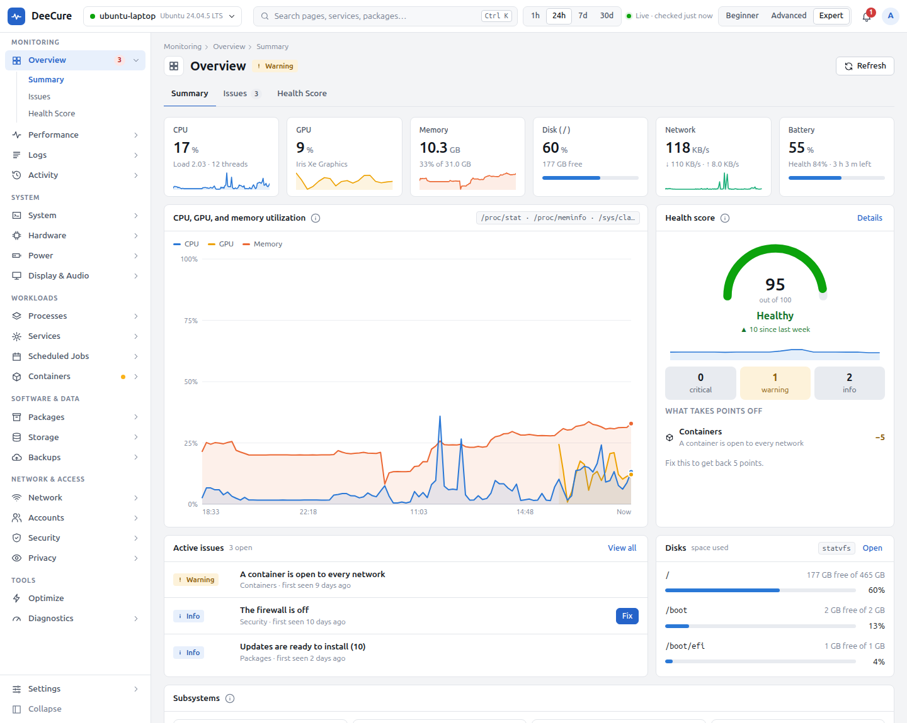
</picture>

*The Overview on a real Ubuntu 24.04 laptop: health score, CPU, GPU, memory, disk, network, and battery at a glance, with the problems to look at. Every screenshot here is the Expert view; the Beginner view shows the same in fewer pages. [More screenshots](#what-the-expert-view-shows).*

## Install in one step

On **Ubuntu 24.04 LTS or 26.04 LTS**, open the Terminal (`Ctrl` + `Alt` + `T`) and paste:

```bash
curl -fsSL https://raw.githubusercontent.com/krisskad0/DeeCure/main/packaging/install.sh | sudo sh
```

Then open **DeeCure** from the app menu. It updates itself after that: it tells you when a new version is out and installs it after your OK. [All install options](docs/07-user-guide/install.md)

---

## Contents

- [What DeeCure does for you](#what-deecure-does-for-you)
- [Common problems it solves](#common-problems-it-solves)
- [Who it is for](#who-it-is-for)
- [Features](#features)
- [Beginner, Advanced, and Expert views](#beginner-advanced-and-expert-views)
- [Private and safe by design](#private-and-safe-by-design)
- [Use it from the terminal](#use-it-from-the-terminal)
- [How it works](#how-it-works)
- [FAQ](#faq)
- [Roadmap](#roadmap)
- [Build from source](#build-from-source)
- [Documentation, contributing, security, license](#documentation)

## What DeeCure does for you

1. **Shows how healthy your computer is**: a health score, the problems behind it, and how busy your CPU, graphics (GPU), memory, disk, and network are, all on one screen.
2. **Warns you early**: about overheating, a disk that will be full soon, a wearing SSD, a failing battery, memory errors, or security updates that silently stopped. It judges each part against **its own limits**, not one number for every computer.
3. **Explains everything in plain English**: what a service does, what a log error means, why the computer is slow. Over 130 built-in explanations, right where you need them.
4. **Fixes problems safely**: 47 fixes, each showing its exact steps before it runs, with your password only for admin steps, a check afterwards, and undo.
5. **Gives you control**: battery charge limits, CPU turbo, power saving, sleep and wake-up, and what closing the lid does, all kept after a restart.

It works without a password for looking around. It never changes anything unless you ask.

## Common problems it solves

| Your question | What DeeCure shows or does |
| --- | --- |
| **Why is my Ubuntu computer slow?** | Names the cause (CPU, memory, disk, or heat) and the app behind it, using real stall measurements, not guesses |
| **Why is my laptop overheating?** | Each part's own temperature limit, how long it stayed near it, heat slowdowns, and fan checks, with what to do |
| **How do I free up disk space?** | What fills the disk, when it will be full (only from real, lasting growth), and one-click cleanup of caches, old kernels, old snaps, and logs |
| **How do I make my battery last longer?** | Battery health and temperature, charge limits such as 80%, power saving that is offered only when it helps on your laptop |
| **Is my SSD or hard drive failing?** | Drive health (SMART and NVMe): life used, bad sectors, errors, and self-test results, plus a daily check that warns before it fails |
| **What changed after an update?** | A timeline of every package, kernel, config file, device, and crash, with line-by-line config differences |
| **Is my Linux computer secure?** | Updates and whether automatic updates really install, firewall, open ports, AppArmor, Secure Boot, CPU security flaws, SSH and sudo settings |
| **Why does my laptop wake up or drain in sleep?** | Every device allowed to wake it, which one did, and whether the chip reaches its deepest sleep |

## Who it is for

- **New Linux users** who want their computer explained without learning a dozen commands. The **Beginner** view is short and calm.
- **Laptop owners** who care about battery life, heat, and noise.
- **Power users and developers** who want every detail: PCIe link speeds, kernel settings and the file that set them, real memory per app, service sandboxing.
- **People who look after a family or office PC** and want early warnings instead of surprises.

## Features

### Health warnings that respect how you use your computer

- **Harm, not use:** a CPU at 100%, memory full of cache, or a busy disk never warns. Stalls, errors, heat, wear, and risk do.
- **Each part's own limits:** temperatures are checked against the limit each CPU, drive, graphics card, and Wi-Fi chip reports about itself.
- **No false alarms from spikes:** most warnings need the problem to last, for example 5 minutes near the limit.
- **Your rules:** turn any warning off or change when it fires. The safe default is shown next to your value.
- **55 warnings** across CPU, memory, disks, battery, temperatures, fans, graphics, hardware errors, services, packages, network, and security. [Full list](docs/01-product/health-warnings.md)

### A complete, honest view of your hardware

- **CPU and graphics:** speed per core, temperatures and limits, heat slowdowns, power use, how busy the GPU is, which app keeps a second graphics card awake.
- **Memory:** where every byte goes, real memory per app, swap, memory slots and their speed, memory errors.
- **Disks and SSDs:** health and wear, NVMe details, whether the drive runs at full PCIe or SATA speed, TRIM, filesystem errors.
- **Battery and power:** health, temperature, charge limits, USB-C chargers, every wake-up source.
- **Firmware and devices:** firmware updates, the firmware security level, Secure Boot, TPM, BIOS settings, USB speeds, screens, cameras, sound.

A value DeeCure cannot read is shown as unknown, never guessed.

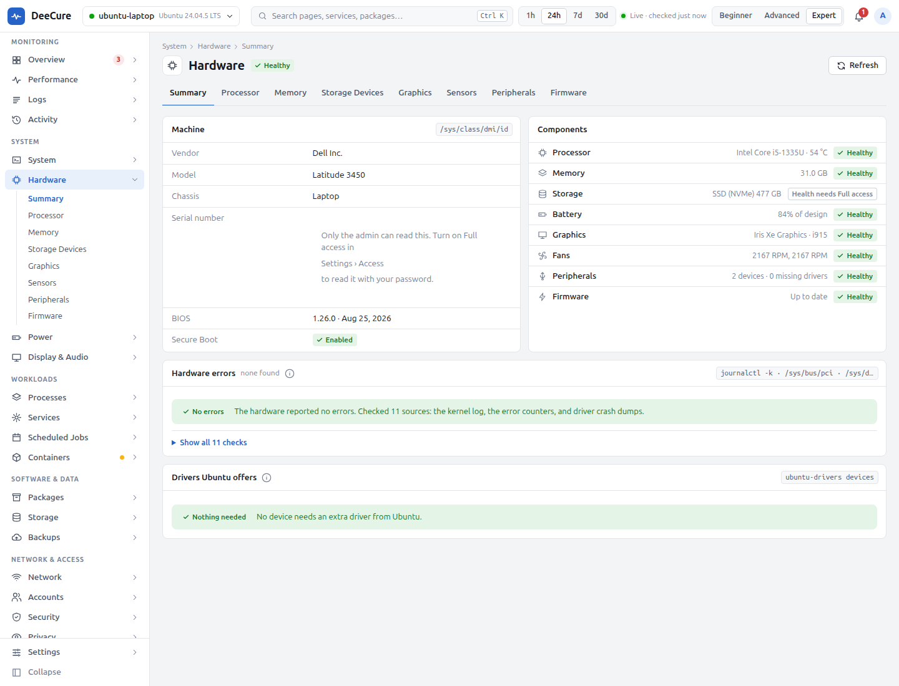

### Optimize: only what your computer actually needs

Improvements are offered **only when a measurement on this computer shows they help**, with the numbers behind each one: unused packages, a log size cap, compressed swap when swapping stays high, a charge limit when the laptop is mostly plugged in, the right hardware video driver, firmware updates. Popular "speed-up tips" that do not help on Ubuntu are never offered. [Optimize catalog](docs/01-product/optimize-catalog.md)


### Battery and power controls

Battery charge limits (presets or your own), charge mode, CPU turbo, the highest CPU speed on battery, PCIe and device power saving, sleep type, lid action, keyboard backlight, and radios. Risky settings are tried for one session first and kept only when you choose **Keep**.

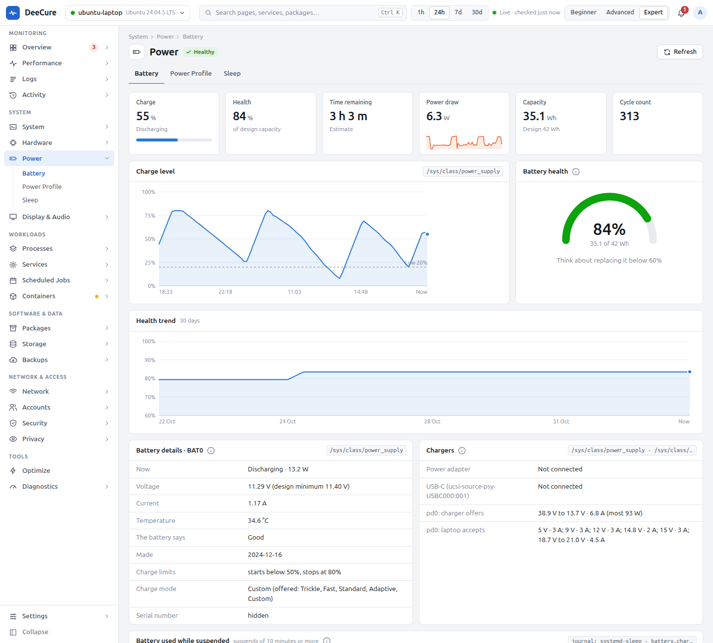

### Safe fixes with undo

Every fix shows its steps and commands first. Untick any step. Admin steps ask for your password through the normal Ubuntu dialog. DeeCure checks the result and keeps an undo, and tells you before running a step that cannot be undone.

### What changed, forecasts, and notifications

- **Timeline** of package installs and upgrades (apt, snap, Flatpak), config changes, USB devices, boots, crashes, and hardware errors, for the last 7, 30, or 90 days.
- **Disk forecast:** "full in about N days", only when the disk keeps filling, so one big install never causes a false alarm.
- **Notifications** for critical problems, with quiet hours, and a weekly summary of your computer's health.

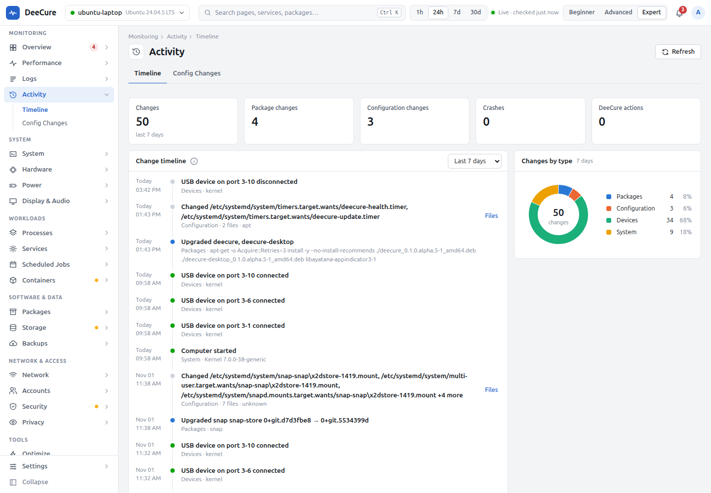

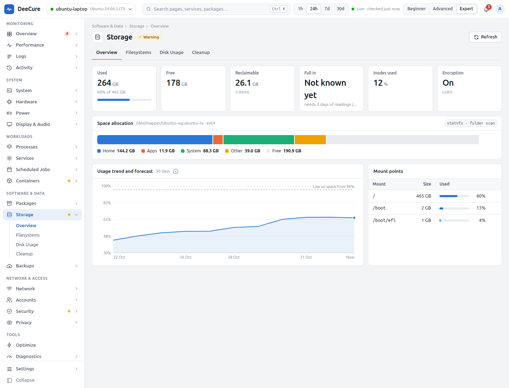

*All screenshots are from a real Dell laptop running Ubuntu 24.04, in the Expert view. The computer and user names are replaced.*

## Beginner, Advanced, and Expert views

- **Beginner** (default): 8 pages in plain words. Ideal if you are new to Linux.
- **Advanced:** every page: logs, services, scheduled jobs, containers, network, accounts, and more.
- **Expert:** everything above, plus deep hardware data, exact commands, data sources, and the Optimize page.

Switch at any time from the top bar. [View levels](docs/01-product/view-levels.md)

### What the Expert view shows

<table>
  <tr>
    <td width="50%"><a href="docs/07-user-guide/images/deecure-expert-processor-cores-power-limits.png">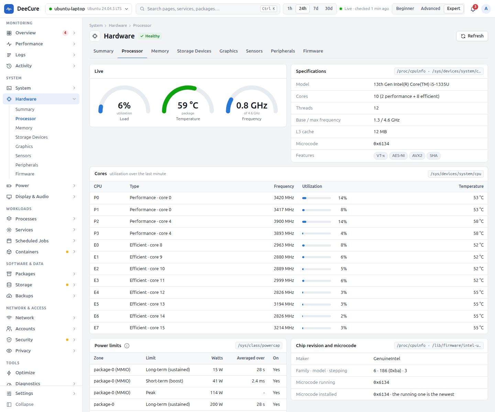</a><br><b>Processor:</b> every core's speed, use, and temperature, and the chip's power limits.</td>
    <td width="50%"><a href="docs/07-user-guide/images/deecure-expert-temperature-sensors-fans.png">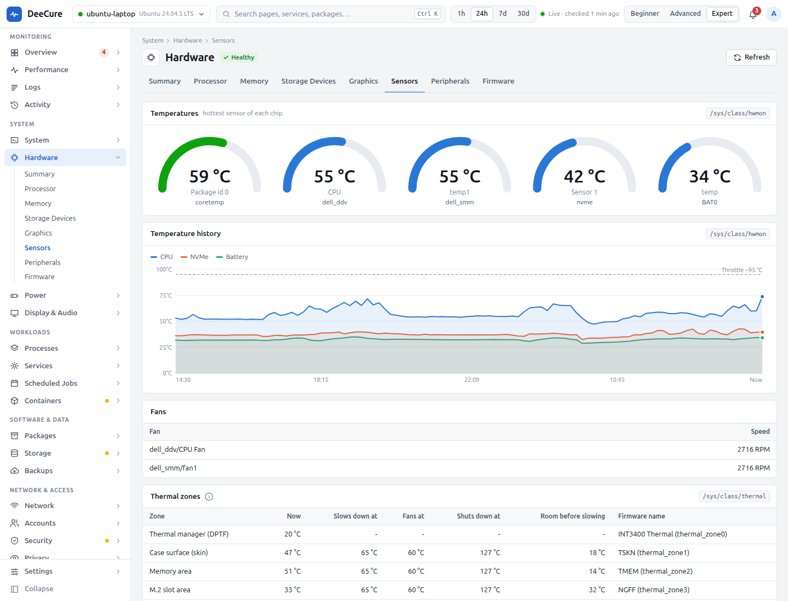</a><br><b>Sensors:</b> every temperature with its own limits, fans, and thermal zones.</td>
  </tr>
  <tr>
    <td width="50%"><a href="docs/07-user-guide/images/deecure-expert-nvme-ssd-details.png">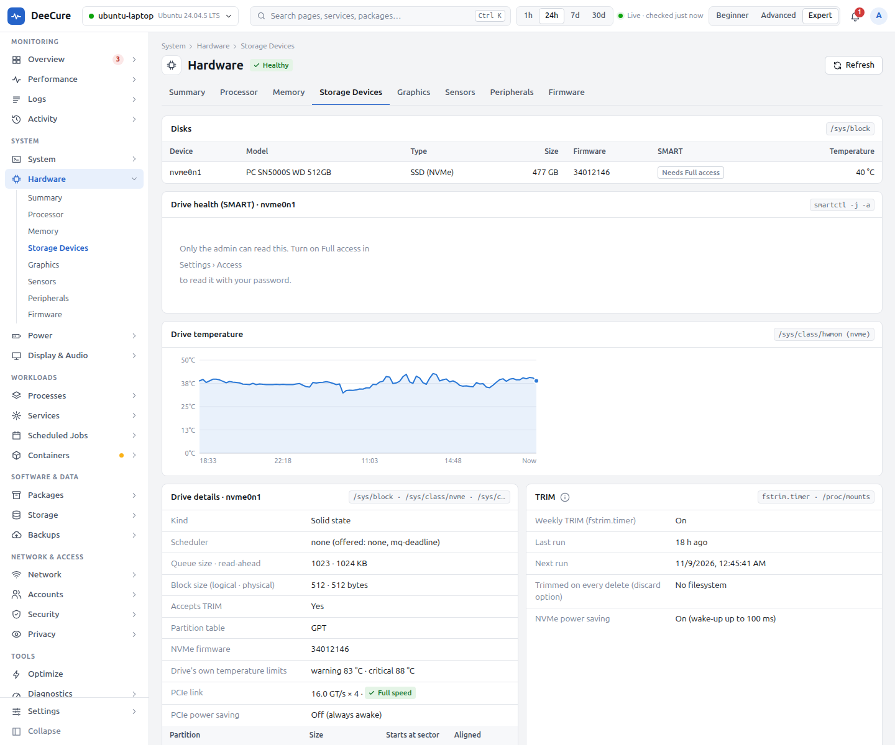</a><br><b>Drives:</b> NVMe details, the drive's own limits, PCIe link speed, and TRIM.</td>
    <td width="50%"><a href="docs/07-user-guide/images/deecure-expert-sleep-wake-power-saving.png">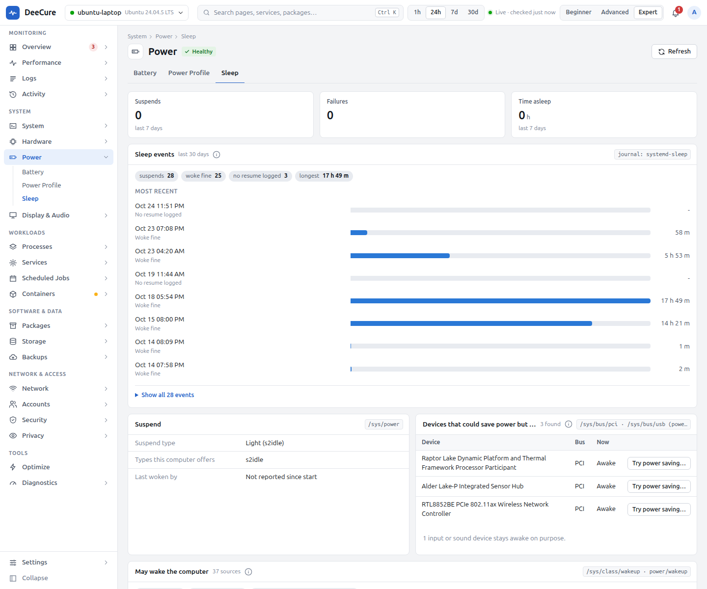</a><br><b>Sleep:</b> every suspend, what woke the laptop, and devices that waste power.</td>
  </tr>
  <tr>
    <td width="50%"><a href="docs/07-user-guide/images/deecure-expert-linux-kernel-modules.png">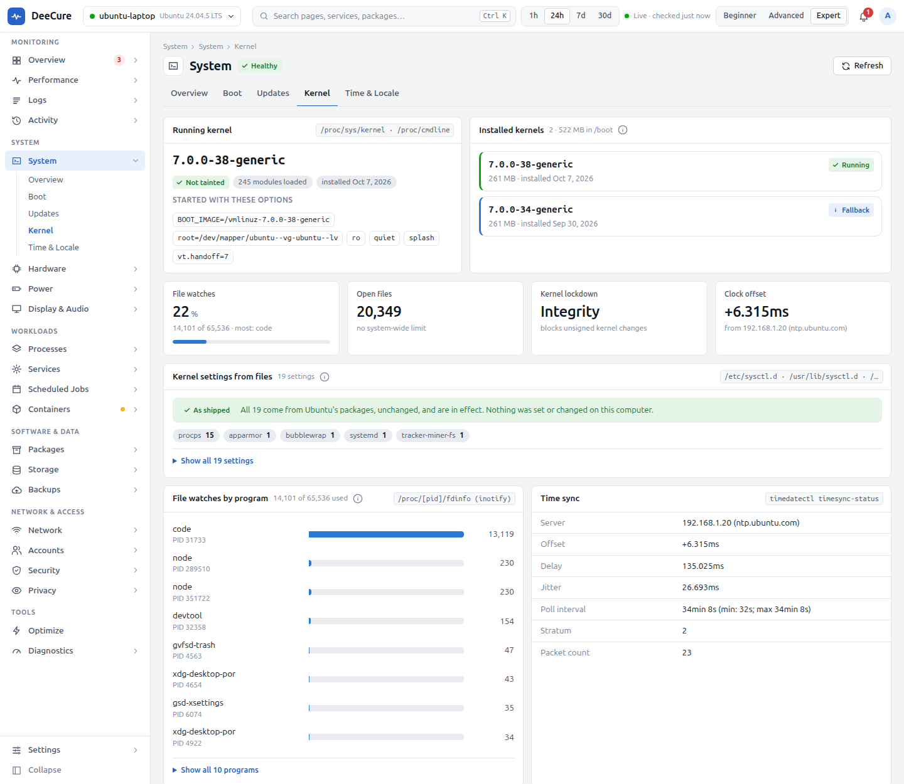</a><br><b>Kernel:</b> installed kernels, loaded modules, limits, and settings with the file that set them.</td>
    <td width="50%"><a href="docs/07-user-guide/images/deecure-expert-optimize-improvements.png">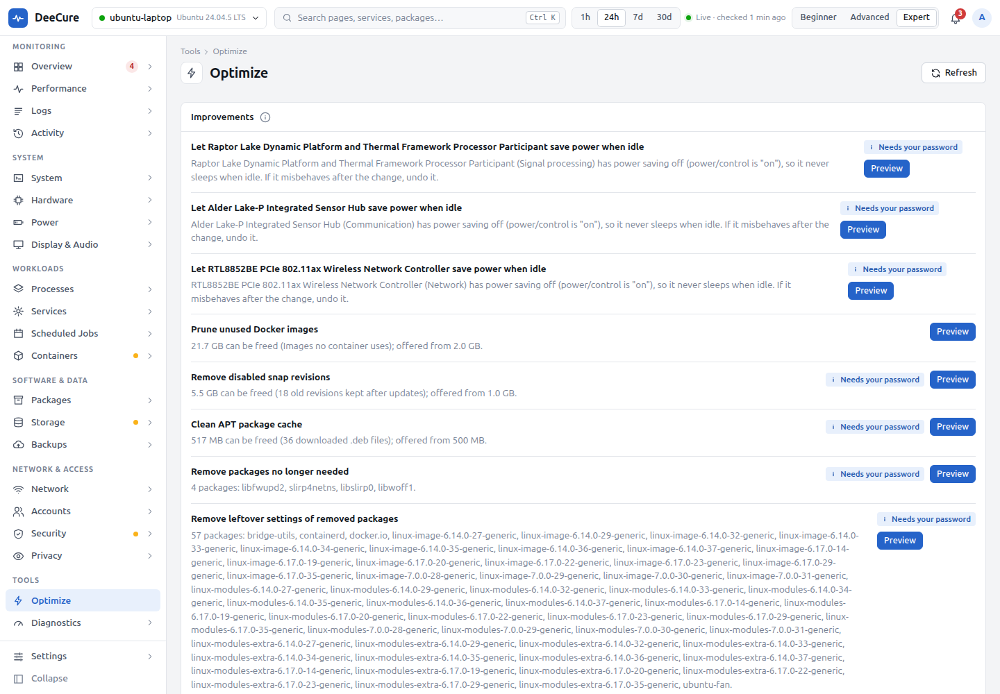</a><br><b>Optimize:</b> only the improvements this computer measurably needs.</td>
  </tr>
  <tr>
    <td width="50%"><a href="docs/07-user-guide/images/deecure-expert-memory-map.png"></a><br><b>Memory:</b> what really fills RAM, what can be freed, and who uses it.</td>
    <td width="50%"><a href="docs/07-user-guide/images/deecure-expert-health-score-breakdown.png">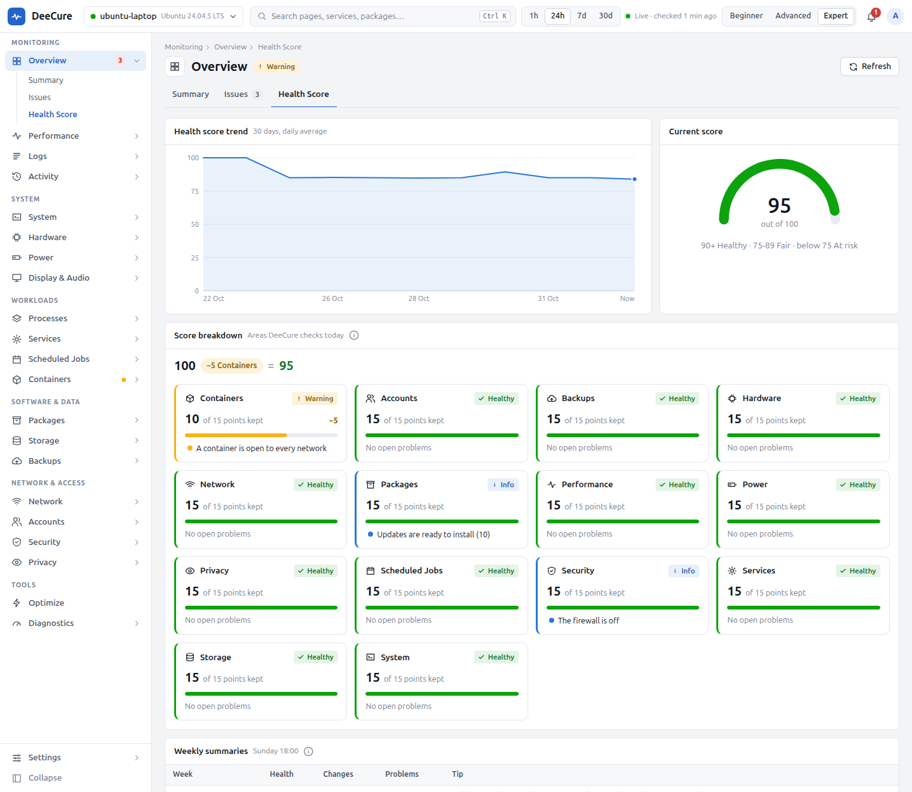</a><br><b>Health score:</b> how the score is reached, area by area.</td>
  </tr>
</table>

## Private and safe by design

- **Your data stays on your computer.** No account, no telemetry, no cloud. The only connection is the update check, which asks GitHub for DeeCure's release list and sends nothing about your computer. You can turn it off.
- **Read-only by default.** About 80% of DeeCure works without a password.
- **A small, strict admin helper.** Admin steps go through a tiny root helper with a fixed list of actions, each with its own password prompt, input checks against the live system, no shell, and an audit log.
- **Light on resources.** About 0.1% CPU when idle and about 21 MB of memory.
- **Checked releases.** Every update is verified against the release checksums before it installs. Releases come with signed build provenance and a software bill of materials. [Security policy](SECURITY.md)

## Use it from the terminal

Everything also works on servers without a desktop:

```bash
deecure status                    # health score and problems, in plain English
deecure history --since 2d        # what changed in the last 2 days
deecure report --html report.html # a 7-day report to share
deecure fix --list                # every available fix
deecure fix storage.free_space    # preview a fix, then run it after you say yes
deecure undo 12                   # take a fix back
```

Add `--json` for scripts. [User guide](docs/07-user-guide/using-deecure.md)

## How it works

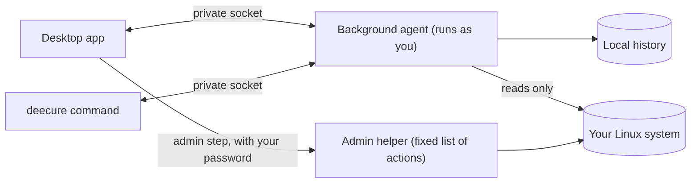

1. A small **background agent** runs as your normal user. Every minute it reads the system, keeps a compact history (two years in under 200 MB), and checks it for problems.
2. The **desktop app** and the **`deecure` command** ask the agent over a private connection only your user can open.
3. **Admin steps** go to the **admin helper**, which starts only when needed and stops after two idle minutes.

Built with Rust, Tauri, React, TypeScript, and SQLite. [Architecture](docs/02-architecture/overview.md)

## FAQ

**What is DeeCure?**
A free, open-source system monitor, health checker, and optimizer for Linux. It shows how your computer is doing, explains it in plain English, warns about real problems early, and fixes them safely with undo.

**Is DeeCure free?**
Yes. It is free and open source under the Apache 2.0 license, with no paid version, ads, or account.

**Is it an alternative to GNOME System Monitor, htop, or TLP?**
It shows what a system monitor shows (processes, CPU, memory, disk, network) and goes further: each part's own limits, drive health, firmware, what changed, warnings, and fixes. It also has battery and power controls, so many laptop users will not need a separate power tool.

**Does it send my data anywhere?**
No. Only the update check connects to the internet, and it sends nothing about your computer. Set it to Never in Settings to stay fully offline.

**Will it slow my computer down?**
No. The agent uses about 0.1% CPU when idle and about 21 MB of memory. Deep details are read only while you look at them.

**Does it need root or my password?**
Not to look around. Your password is asked only for admin fixes and admin details, through the standard Ubuntu dialog.

**Can a fix break my system?**
Every fix shows its exact steps first, lets you skip any step, checks the result, and keeps an undo where possible. Risky power settings are tried for one session before they are kept.

**Will it warn me all the time?**
No. Normal use never warns, short spikes never warn, and you can turn off or change any warning.

**Can I set a battery charge limit on Ubuntu with it?**
Yes, when your laptop supports it (many Dell, Lenovo, ASUS, and other laptops do): presets such as 80%, or your own values, kept after restart.

**Can it check my SSD health?**
Yes. It shows SSD and hard drive health (life used, bad sectors, errors, self-tests) and warns before a drive wears out. Install `smartmontools` for the full drive check.

**How does it update?**
It checks for a new version daily (or weekly, or never), tells you once, and installs it after your OK, or automatically if you choose. Every package is verified before it installs.

**Which Linux versions are supported?**
Ubuntu 24.04 LTS and 26.04 LTS on 64-bit PCs (amd64). Debian, Fedora, Arch, and KDE Plasma are planned.

## Roadmap

| Stage | What | State |
| --- | --- | --- |
| Foundation | Background agent, history, warnings, desktop app with real data on every page | Built |
| Fixes | Safe fixes with undo, admin helper, Ubuntu packages | Built; wider real-machine testing and a security review in progress |
| Insight | What-changed timeline, forecasts, notifications, weekly report, tray icon | Built |
| Expert | Three view levels, deep hardware data, power controls, Optimize, admin details | Built |
| Ask DeeCure | A private, local assistant that answers questions about your computer, with sources | Planned |
| More platforms | More distributions, KDE Plasma, server mode, several computers | Planned |

DeeCure is in **pre-release**: it is used daily, but expect changes before version 1.0. See the [latest release](https://github.com/krisskad0/DeeCure/releases), the [roadmap](docs/05-roadmap/README.md), and the [changelog](CHANGELOG.md).

## Build from source

On Ubuntu 24.04 or newer, with Rust, Node.js 22, and a few system libraries ([getting started](docs/04-development/getting-started.md)):

```bash
git clone https://github.com/krisskad0/DeeCure.git
cd DeeCure
make agent        # terminal 1: start the background agent
make app          # terminal 2: start the desktop app
```

## Documentation

Start at [docs/README.md](docs/README.md).

| Folder | What's inside |
| --- | --- |
| [User guide](docs/07-user-guide/README.md) | Install and everyday use |
| [Product](docs/01-product/README.md) | Vision, view levels, health warnings, Optimize |
| [Architecture](docs/02-architecture/README.md) | Agent, collectors, warnings, fixes, admin helper, storage, security |
| [UI design](docs/03-ui-design/README.md) | Design tokens, layout, components, pages |
| [Development](docs/04-development/README.md) | Setup, project structure, writing rules, testing |
| [Roadmap](docs/05-roadmap/README.md) | Plan and what is left |
| [Packaging](docs/06-packaging/README.md) | Packages, APT repository, releases |
| [Contributing](docs/08-contributing/README.md) | Issues, pull requests, reviews |

## Contributing

You can help without writing Rust: add checks and plain-English explanations in simple YAML files, share test data from your laptop, report a bug, or improve the docs. See [CONTRIBUTING.md](CONTRIBUTING.md).

## Security

Please report security problems privately. See [SECURITY.md](SECURITY.md).

## License

[Apache License 2.0](LICENSE). Free to use, change, and share.
