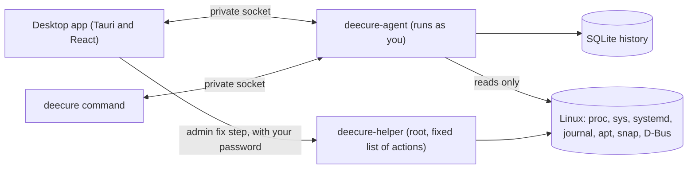

# DeeCure: Linux PC health check, system monitor, and safe one-click fixes for Ubuntu

[](https://github.com/krisskad0/DeeCure/actions/workflows/ci.yml)
[](LICENSE)


**DeeCure is a free, open-source "doctor" for your Linux computer.** It checks your whole PC (hardware, Ubuntu, apps, services, storage, network, and security), explains every problem in plain English, and fixes it safely with a preview and an undo button. Everything stays on your computer.

> **In one sentence:** DeeCure tells you *what is wrong with your Linux PC, why, and how to fix it*, the way a good friend who knows Linux would.

> **Status:** in active development, not released yet. The agent, the desktop app, the command line, history, notifications, and safe fixes are built and tested (Phases 0-3). See the [roadmap](docs/05-roadmap/README.md) and [what is left](docs/05-roadmap/pending.md).

---

## Why DeeCure?

Linux shows you numbers: 94% disk, 3 failed units, load 4.2. Most people then search forums and paste commands they do not understand. DeeCure closes that gap:

| Problem | What DeeCure does |
| --- | --- |
| "My disk is full and I don't know what is using it." | Shows what takes the space (old snap versions, apt cache, Docker images, Trash), predicts **when the disk will be full**, and frees space with one click. |
| "Why is my PC slow?" | A 10-second check names the main cause (CPU, memory, disk, or heat) and the app behind it. |
| "Something broke after an update." | A **what-changed timeline** shows every package, kernel, config file, and device change, and how to start the previous kernel. |
| "Is my computer safe?" | Checks updates, the firewall, open ports, SUID programs, kernel hardening, and extra admin accounts, without asking for your password. |
| "What is this service? Can I turn it off?" | 132 plain-English explanations of services, ports, log errors, and packages, right where they appear. |

## Features

- **One health score (0-100)** for the whole computer, with the most serious problems first.
- **21 areas, about 90 views, all with real data:** performance (CPU, memory, disk I/O, network, GPU, pressure), hardware and sensors, battery, displays and audio, storage, services, scheduled jobs, logs and crashes, packages (deb, snap, Flatpak), containers and VMs, network and firewall, accounts and SSH, security, privacy, and backups.
- **Safe fixes with undo:** 22 fixes, each with a preview of the exact steps and commands. Untick any step. Admin steps ask for your password through the normal Ubuntu dialog. DeeCure checks that the fix worked, and keeps an undo for every step that can be undone.
- **What changed:** a timeline of package installs and upgrades (apt, dpkg, snap, Flatpak), config file changes with a line-by-line diff, USB devices, boots, crashes, and failed jobs.
- **Predictions:** "Your disk will be full in about 3 days", from the last 7 days of history.
- **Notifications that respect you:** critical problems right away, quiet hours, and never the same alert twice in 24 hours.
- **Weekly report:** health trend, what changed, and one tip, as a notification and as a shareable HTML file.
- **Beginner and Expert modes:** plain words by default; data sources, commands, and raw columns for experts.
- **Works in the terminal too:** `deecure status`, `deecure history`, `deecure report --html`, `deecure fix`, and JSON output for scripts and servers.
- **Private by design:** no account, no telemetry, nothing sent anywhere.

## How DeeCure works



1. **The agent** runs in the background as your normal user. Every minute it reads the system (CPU, memory, disks, sensors, battery, network, services, updates, logs), keeps a compact history, and runs **16 YAML rules** that turn data into findings.
2. **The desktop app and the `deecure` command** ask the agent over a private Unix socket that only your user can open.
3. **Fixes** run in your own session. Steps that need admin rights go to a tiny **root helper** that knows only 12 fixed actions. polkit asks for your password for each one, every input is checked, and every call is written to an audit log. The helper starts only when needed and exits after 2 idle minutes.
4. **The knowledge base** turns technical names into plain English: what `cups-browsed` is, what port 5432 is, what "ACPI BIOS Error" means, and whether you should care.

Read more: [architecture overview](docs/02-architecture/overview.md).

## How advanced is it?

DeeCure is built like system software, not like a script collection:

- **Small and fast:** the agent is written in Rust. Measured on a real laptop: about 19 MB of memory, about 0.4% CPU when idle, and first results in about 1.5 seconds.
- **Two years of history in under 200 MB:** minute data for 7 days, 15-minute averages for 90 days, daily averages for 2 years. A test that simulates 2 years on a big machine (150 metric series) ends at 124 MB, and runs in CI.
- **Safe by design:** read-only by default; the root helper has a fixed list of actions, strict input checks, no shell, systemd sandboxing, and an audit log. No fix runs without a preview.
- **Honest data:** a value DeeCure cannot read is shown as unknown, never guessed. Rules never act on stale or missing data.
- **No surprises:** DeeCure never starts a service by asking it something, never uses up your editor's file watchers (config changes are found by comparing scans), and never sends data anywhere.
- **Well tested:** about 270 Rust tests and 120 UI tests, replays of real machines' `/proc` and `/sys`, container tests of the `.deb` packages, and an end-to-end test of the root helper with real D-Bus and polkit.

## Use cases

- **Home users and beginners** who want their Ubuntu laptop to "just work" and understand what it is doing.
- **Developers** who want one place for disk space, Docker leftovers, open ports, failed services, and slow boots.
- **People helping family and friends** with Linux: the weekly report and plain-English explanations make remote help easy.
- **Small offices and servers:** the `deecure` command works without a desktop, with JSON output (multi-PC view is planned).

## Try it (developers)

DeeCure is not released yet. To build and run it from source on Ubuntu 24.04 or newer:

```bash
git clone https://github.com/krisskad0/DeeCure.git
cd DeeCure
make agent        # terminal 1: start the background agent
make app          # terminal 2: start the desktop app
make status       # or ask from the terminal
```

You need Rust, Node.js 22, and a few system libraries: see [Getting started](docs/04-development/getting-started.md).

Command-line examples:

```bash
deecure status                    # health score and problems, in plain English
deecure history --since 2d        # what changed in the last 2 days
deecure report --html report.html # a 7-day report to share
deecure fix storage.free_space    # preview a fix, then run it after you say yes
deecure undo 12                   # take a fix back
```

When it is released, installing will be one command, with updates through Software Updater: see the [install guide](docs/07-user-guide/install.md).

## FAQ

**Is DeeCure free?** Yes. It is open source under the Apache 2.0 license.

**Does DeeCure send my data anywhere?** No. There is no account, no telemetry, and no cloud. Everything is read and kept on your computer.

**Does it need root or my password?** No, not to look. About 80% of the checks work with your normal account. Your password is asked only for admin fixes and admin read-outs (such as disk health), each time, through the standard Ubuntu dialog.

**Which Linux versions does it support?** Ubuntu 24.04 LTS and 26.04 LTS first. Debian, Fedora, Arch, and KDE are planned.

**Can a fix break my system?** Every fix shows its exact steps and commands first, lets you untick any step, checks the result, and keeps an undo when the step can be undone. Steps that cannot be undone are marked clearly.

**How is it different from a system monitor?** System monitors show numbers. DeeCure explains them, ranks what matters, predicts problems, remembers what changed, and fixes things safely.

## Roadmap

| Phase | What | State |
| --- | --- | --- |
| 0-1 | Agent, history, rules, desktop app with real data on every page | Built |
| 2 | Safe fixes, root helper, undo, signed APT repository | Built; real-machine test matrix and security review pending |
| 3 | What-changed timeline, predictions, notifications, weekly report, tray icon | Built |
| 4 | "Ask DeeCure": a private, local AI that answers questions with sources | Planned |
| 5 | More distros, KDE, server mode, many PCs | Planned |

Details: [docs/05-roadmap](docs/05-roadmap/README.md).

## Documentation

Start at [docs/README.md](docs/README.md).

| Folder | What's inside |
| --- | --- |
| [01-product](docs/01-product/README.md) | Vision, users, user journey, insights catalog, open decisions |
| [02-architecture](docs/02-architecture/README.md) | Components, collectors, storage, rules, fixes, helper, notifications, security |
| [03-ui-design](docs/03-ui-design/README.md) | Design tokens, shell, components, pages |
| [04-development](docs/04-development/README.md) | Setup, repo layout, writing rules, testing |
| [05-roadmap](docs/05-roadmap/README.md) | Phase-by-phase plan and the pending list |
| [06-packaging](docs/06-packaging/README.md) | `.deb` packages, APT repository, releases |
| [07-user-guide](docs/07-user-guide/README.md) | Install and everyday use |

## Built with

Rust (agent, root helper, CLI, fix runner) · Tauri v2 + React + TypeScript (desktop app) · SQLite · zbus (D-Bus) · polkit · YAML rules and knowledge base · our own SVG charts.

## Repository layout

```
app/          Desktop app (Tauri v2 + React + TypeScript)
crates/       Rust workspace: deecure-core, deecure-agent, deecure-cli, deecure-fix, deecure-helper
rules/        Checks (YAML), one folder per area
kb/           Plain-English knowledge base (YAML)
packaging/    Debian packages, desktop files, D-Bus, polkit, systemd, install script, APT repo
scripts/      Developer and release scripts
tests/        Real-machine fixtures and VM tests
docs/         Documentation
```

Details: [project structure](docs/04-development/project-structure.md).

## Contributing

You can help without writing Rust: add checks and plain-English explanations in YAML, share test data from your laptop, or improve the docs. See [CONTRIBUTING.md](CONTRIBUTING.md).

## Security

Please report security problems privately. See [SECURITY.md](SECURITY.md).

## License

[Apache License 2.0](LICENSE).

---

*Keywords: Linux system monitor, Ubuntu health check, PC doctor for Linux, Linux troubleshooting, disk space cleanup, why is my Linux PC slow, failed systemd services, Linux security check, what changed after update, Ubuntu maintenance tool.*
