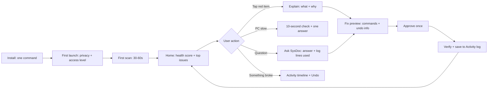

# User journey (step by step)

[Docs](../README.md) › [Product](README.md)

## Install

1. The user finds SysDoc on the website or in a blog post.
2. They copy one command:
   ```bash
   curl -fsSL https://<site>/install.sh | sudo bash
   ```
   This adds the SysDoc apt repository and installs the `.deb` package. A normal `.deb` download is offered too.
3. After install, SysDoc appears in the app menu.

> **Real-life example:** Riya follows a YouTube tip, pastes one command, and enters her password once. Two minutes later SysDoc is in her app list.

## First launch (3 short screens)

1. **Welcome:** "SysDoc checks your computer and explains problems in simple words."
2. **Privacy promise:** "Everything stays on this computer. No account. No data sent anywhere."
3. **Choose access level:**
   - **Basic (no password):** sees about 80% of insights.
   - **Full (recommended):** approves the SysDoc helper once with the admin password. This unlocks disk health, firewall, all users' cron jobs, and similar items.

The user can switch the level later in Settings.

## First scan (about 30–60 seconds)

1. A progress screen fills in category by category: "Checking hardware… Checking apps… Checking security…"
2. Results appear as soon as each category finishes, so there is no blank waiting.
3. The deep disk-usage scan keeps running quietly in the background and finishes later.

## Home screen (Overview › Summary)

The app opens on a dashboard, not a list of cards. See `sysdoc-dashboard.html` for the clickable version.

```
┌ Top bar: SysDoc · machine picker · search (Ctrl K) · 1h/24h/7d/30d · Beginner/Expert · bell ┐
├──────────┬──────────────────────────────────────────────────────────────────────────────────┤
│ Sidebar  │ Monitoring › Overview                       [Refresh] [Export]                   │
│ (pages + │ Summary | Issues (8) | Health Score                                             │
│ sub-     ├──────────────────────────────────────────────────────────────────────────────────┤
│ pages)   │ [Health 82/100] [CPU 12%] [Memory 5.9 GB] [Disk 94%] [Network 1.2 MB/s] [Battery]│
│          │ ┌ CPU & memory chart (time range) ──────────┐ ┌ Subsystems (status list) ┐      │
│          │ └───────────────────────────────────────────┘ └──────────────────────────┘      │
│          │ ┌ Active issues table (Resolve / Inspect) ──┐ ┌ Health score gauge ──────┐      │
│          │ ┌ Disk donut ┐ ┌ Top processes ┐ ┌ System facts ┐                             │
│          │ ┌ Recent activity timeline ┐ ┌ Errors-by-hour heatmap ┐                         │
└──────────┴──────────────────────────────────────────────────────────────────────────────────┘
```

- **Stat tiles** at the top show the key number for each area, with a sparkline or usage bar. Clicking a tile opens that page.
- **Status colors** are fixed: green = Healthy, yellow = Warning, red = Critical, blue = Info, grey = Unknown. Every color comes with an icon and a word, so it never relies on color alone.
- **Active issues** is a table. Each row has one action button (Resolve, Inspect, Install, View).
- **The time range** in the top bar (1h, 24h, 7d, 30d) redraws every chart on every page.

## Fixing a problem (the core flow)

**Example:** "Disk 94% full."

1. **Tap the red item.** SysDoc shows:
   - What it means: "Your main disk is almost full. Apps may crash and updates may fail."
   - Why it happened: "Old snap versions 9 GB · Docker images 4 GB · Trash 2 GB."
2. **Tap Fix.** A preview screen lists each step:
   - "Remove 6 old snap versions (9 GB). Command: `snap remove <name> --revision=<n>`. Undo: No, but these are old copies; your current apps stay."
   - "Empty Trash (2 GB). Undo: No. Files in Trash will be gone."
   - The user can untick any step.
3. **Tap Apply.** If a step needs admin rights, the normal Ubuntu password box appears once.
4. **SysDoc checks the result:** "Done. Disk now 79% full. Health 82 → 90."
5. The action is saved in **Activity › SysDoc Actions**, with an Undo button where undo is possible.

## "Why is my PC slow?" (Diagnostics › Performance Check)

1. The user taps the button while the PC feels slow.
2. SysDoc takes a 10-second look at CPU, RAM, memory pressure, disk activity, temperature, and the top apps.
3. It answers in one sentence plus one action:
   - "Chrome is using 6.1 GB of your 8 GB RAM (42 tabs). Closing unused tabs will help."
   - "Your CPU is at 95 °C and slowing itself down. Check that the air vents are not blocked."
4. Each answer has a **Show details** link for experts.

## Ask SysDoc (Assistant › Chat)

1. The user types or says: "Why did my laptop restart last night?"
2. SysDoc looks at the boot list and the last log lines before the restart.
3. It answers: "Your laptop did not shut down cleanly at 2:14 AM. The last logs show the battery at 1%. It most likely ran out of power." It also shows the 3 log lines it used.
4. If the AI suggests a fix, the fix still goes through the normal preview → approve → undo flow. The AI can never run commands directly.

## Everyday use

- SysDoc runs quietly in the background. It shows a small tray icon only if the user wants one.
- **Notifications** appear only for serious things, such as "Disk will be full in about 3 days" or "SSD health dropped to 15%".
- A **weekly report** (optional) gives the health trend, what changed, and one tip.

## Something broke after a change

**Example:** Wi-Fi stopped working today.

1. The user opens **Activity › Timeline** (the "what changed" timeline).
2. They see: "Yesterday 6:40 PM — kernel updated 6.8 → 6.11" and "Yesterday 6:41 PM — Wi-Fi driver module changed".
3. SysDoc suggests: "Start once with the previous kernel from the boot menu. Here is how."
4. If SysDoc itself made a change, there is an **Undo** button right there.

## Growing into an expert

- **Beginner mode** (default) shows the dashboard with plain labels, info tooltips, and one-click fixes.
- **Expert mode** adds the data source on every panel (for example `ss -tulpn`), extra table columns (MAC address, swap per process, threads), and full logs.
- Every fix always shows its exact command before it runs, so beginners learn real Linux commands slowly.

## Uninstall

- The user runs `sudo apt remove sysdoc` or clicks Uninstall in Settings.
- SysDoc asks: "Also delete history and settings?"
- The admin helper and its permissions are removed completely.

## Journey at a glance


