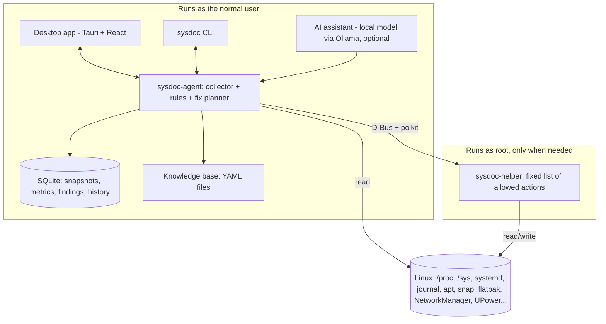

# Architecture overview

[Docs](../README.md) › [Architecture](README.md)

## Components

| Component | Runs as | Job |
| --- | --- | --- |
| **sysdoc-agent** | Normal user (systemd user service) | Collects data, runs rules, plans fixes, stores history, serves the UI |
| **sysdoc-helper** | Root, started by D-Bus only when called | Runs a fixed list of allowed admin actions, and reads admin-only data |
| **Desktop app** | Normal user | All screens; talks to the agent over a local socket |
| **CLI** | Normal user | `sysdoc status`, `sysdoc slow`, `sysdoc fix <id>`, and JSON output for scripts |
| **Knowledge base** | Files shipped with the app | Plain-English meanings of services, errors, ports, and packages |
| **AI assistant** | Normal user, optional | Answers questions using only read-only data from the agent |

## Tech stack (and why)

| Part | Choice | Why |
| --- | --- | --- |
| Agent and helper | **Rust** | Small memory use, no runtime to install, safe for a root helper. Go is a fine alternative if the team knows it better. |
| D-Bus | `zbus` crate | Talks to systemd, NetworkManager, UPower, BlueZ, and the helper |
| Journal | sd-journal bindings | Fast reading and filtering of logs without spawning `journalctl` |
| Storage | **SQLite** (WAL mode) | One file, no server, easy backup |
| Desktop UI | **Tauri v2 + React + TypeScript** | Much lighter than Electron, and uses web skills. Svelte is fine if preferred. |
| Charts | Lightweight chart library (e.g. uPlot) | Fast with long time series |
| AI | **Ollama** with a small local model (about 3–8B) | Private and offline. A cloud model only with explicit opt-in. |
| Rules and KB | **YAML** files | Easy for contributors to add checks without writing code |

## How the parts talk

| From → To | Channel | Format | Notes |
| --- | --- | --- | --- |
| Desktop app → agent | Unix socket `$XDG_RUNTIME_DIR/sysdoc/agent.sock` | JSON-RPC 2.0 (proposed) | The Tauri Rust side holds the connection. The React UI calls Tauri commands. |
| CLI → agent | Same socket | Same | `--json` prints the raw result |
| Agent → helper | D-Bus system bus, name `io.github.sysdoc.Helper1` | D-Bus methods from a fixed list | polkit checks every call |
| Agent → system | `/proc`, `/sys`, journal, D-Bus (systemd, NetworkManager, UPower, BlueZ) | — | Read-only |

**Socket safety:** the socket lives in the user's private runtime folder with mode `0600`. The agent also checks the caller's user ID on every connection.

**How the agent starts:** two systemd user units.

- `sysdoc-agent.socket` starts the agent the first time the app or CLI connects.
- `sysdoc-agent.service` runs the agent. The "Start at login" setting enables it, so data is collected in the background.

**How the helper starts:** D-Bus activation. The D-Bus service file points to a systemd system unit, `sysdoc-helper.service`, so the helper can use systemd sandboxing options.

## Files on disk

| Path | What it is |
| --- | --- |
| `/usr/bin/sysdoc` | CLI |
| `/usr/bin/sysdoc-desktop` | Desktop app |
| `/usr/libexec/sysdoc/sysdoc-agent` | Agent (started by systemd user units) |
| `/usr/libexec/sysdoc/sysdoc-helper` | Root helper (started by D-Bus) |
| `/usr/share/sysdoc/rules/` | Rule YAML files |
| `/usr/share/sysdoc/kb/` | Knowledge base YAML files |
| `/usr/lib/systemd/user/sysdoc-agent.{socket,service}` | Agent units |
| `/usr/lib/systemd/system/sysdoc-helper.service` | Helper unit (D-Bus activated) |
| `/usr/share/dbus-1/system-services/io.github.sysdoc.Helper1.service` | D-Bus activation file |
| `/usr/share/dbus-1/system.d/io.github.sysdoc.Helper1.conf` | D-Bus policy: who may call the helper |
| `/usr/share/polkit-1/actions/io.github.sysdoc.helper.policy` | polkit actions, one per helper action |
| `/usr/share/applications/io.github.sysdoc.SysDoc.desktop` | App menu entry |
| `/usr/share/metainfo/io.github.sysdoc.SysDoc.metainfo.xml` | App store listing (AppStream) |
| `/usr/share/icons/hicolor/scalable/apps/io.github.sysdoc.SysDoc.svg` | App icon |
| `~/.local/share/sysdoc/sysdoc.db` | The user's database (settings live in its `setting` table) |
| `/var/log/sysdoc/helper.log` | Helper audit log |

All names that start with `io.github.sysdoc` are provisional. See [Open decisions](../01-product/open-decisions.md).
