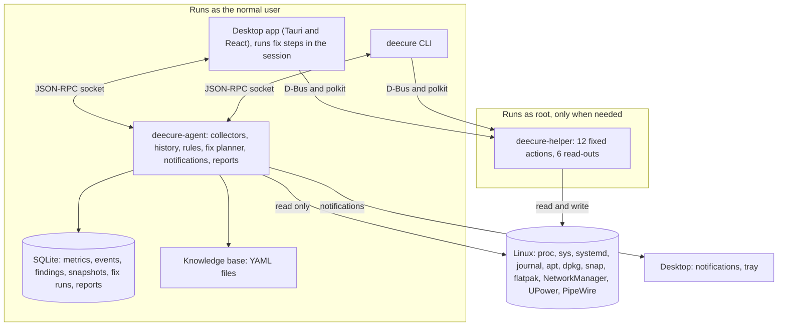

# Architecture overview

[Docs](../README.md) › [Architecture](README.md)

## Components

| Component | Runs as | Job |
| --- | --- | --- |
| **deecure-agent** | Normal user (systemd user service) | Collects data every minute, saves history and what changed, runs the rules, plans fixes, sends notifications and the weekly summary, and answers the app and the CLI |
| **deecure-fix** (library) | Normal user, inside the app or the CLI | Runs the chosen steps of a fix plan in the person's session, so polkit can ask for the password, and takes them back for undo ([Fix engine](fix-engine.md)) |
| **deecure-helper** | Root, started by D-Bus only when called | Runs a fixed list of allowed admin actions and admin-only read-outs, with strict input checks and an audit log ([Helper](helper.md)) |
| **Desktop app** | Normal user | All screens, the fix drawer, the optional tray icon; talks to the agent over the local socket |
| **CLI** | Normal user | `deecure status`, `history`, `report`, `fix`, `undo`, with `--json` for scripts ([CLI](cli.md)) |
| **Knowledge base** | Files shipped with the app | Plain-English meanings of services, errors, ports, packages, and how-to topics |
| **AI assistant** | Planned (Phase 4) | Will answer questions using only read-only data from the agent ([AI assistant](ai-assistant.md)) |

## Tech stack (and why)

| Part | Choice | Why |
| --- | --- | --- |
| Agent, helper, CLI, fix runner | **Rust** ([ADR 0001](decisions/0001-rust-for-agent-helper-cli.md)) | Small memory use, no runtime to install, safe for a root helper |
| D-Bus | `zbus` crate | Talks to systemd, logind, NetworkManager, UPower, BlueZ, fwupd, the desktop, and the helper |
| Journal | `journalctl -o json`, read-only, with a time limit | Works on every systemd system without extra libraries; `--grep` keeps reads small |
| Storage | **SQLite** (the system library, WAL mode) | One file, no server, easy backup; security updates come with Ubuntu |
| Local time | `jiff` | Correct local times for apt and dpkg logs, quiet hours, and the Sunday summary, also across clock changes |
| Desktop UI | **Tauri v2 + React + TypeScript** | Much lighter than Electron, and uses web skills |
| Charts | Our own SVG components ([ADR 0006](decisions/0006-charts-as-own-svg-components.md)) | Small, themeable, and exactly the charts the spec needs |
| AI (planned) | A small local model | Private and offline; a cloud model only with explicit opt-in |
| Rules and KB | **YAML** files | Easy for contributors to add checks without writing code |

## How the parts talk

| From → To | Channel | Format | Notes |
| --- | --- | --- | --- |
| Desktop app → agent | Unix socket `$XDG_RUNTIME_DIR/deecure/agent.sock` | JSON-RPC 2.0, one message per line ([IPC protocol](ipc-protocol.md)) | The Tauri Rust side holds the connection. The React UI calls Tauri commands. |
| CLI → agent | Same socket | Same | `--json` prints the raw result |
| App or CLI → helper | D-Bus system bus, name `io.github.krisskad0.DeeCure.Helper`, interface `…Helper1` | D-Bus methods from a fixed list | polkit asks for the password for each call. Fix steps run in the person's session, never in the agent. |
| Agent → system | `/proc`, `/sys`, `/etc`, logs, `journalctl`, read-only programs (`apt list`, `snap list`, `docker ps`…), D-Bus (systemd, logind, NetworkManager, UPower, BlueZ, fwupd) | - | Read-only. D-Bus services are asked only when they already run, so nothing is started. |
| Agent → desktop | Session D-Bus, `org.freedesktop.Notifications` | Notify | Only when a notification service already runs ([Notifications](notifications.md)) |
| App → app | Unix socket `$XDG_RUNTIME_DIR/deecure/desktop.sock` | `show` | A second start shows the running window instead of opening another copy |

**Socket safety:** the socket lives in the user's private runtime folder with mode `0600`. The agent also checks the caller's user ID on every connection.

**How the agent starts:** two systemd user units.

- `deecure-agent.socket` starts the agent the first time the app or CLI connects.
- `deecure-agent.service` runs the agent. The "Start at login" setting enables it, so data is collected in the background.
- Right after install, the package starts the socket for everyone signed in (and restarts the agent after an upgrade), so nobody has to log out first ([Debian package](../06-packaging/debian-package.md)).
- If the socket is still missing, the app and `deecure` start it themselves (`systemctl --user daemon-reload`, then `start deecure-agent.socket`), at most once a minute, then wait up to 5 s and try again. Only for the default socket path.
- The first history import waits until the first check is done, so the first health score comes fast.

**How the helper starts:** D-Bus activation. The D-Bus service file points to a systemd system unit, `deecure-helper.service`, so the helper can use systemd sandboxing options.

## Files on disk

| Path | What it is |
| --- | --- |
| `/usr/bin/deecure` | CLI |
| `/usr/bin/deecure-desktop` | Desktop app |
| `/usr/libexec/deecure/deecure-agent` | Agent (started by systemd user units) |
| `/usr/libexec/deecure/deecure-helper` | Root helper (started by D-Bus) |
| `/usr/share/deecure/rules/` | Rule YAML files |
| `/usr/share/deecure/kb/` | Knowledge base YAML files |
| `/usr/lib/systemd/user/deecure-agent.{socket,service}` | Agent units |
| `/usr/lib/systemd/system/deecure-helper.service` | Helper unit (D-Bus activated) |
| `/usr/lib/systemd/system/deecure-power.service` | Sets kept power settings again at boot; does nothing until one is kept |
| `/usr/lib/udev/rules.d/90-deecure-power.rules` | Sets the kept CPU limit again when a charger is plugged in or out |
| `/etc/systemd/journald.conf.d/50-deecure-size.conf` | The system log size cap, when set on Optimize |
| `/etc/sysctl.d/60-deecure-inotify.conf` | The file-watch limit, when raised on Optimize |
| `/etc/systemd/logind.conf.d/50-deecure-lid.conf` | What closing the lid does, when changed in the app (written by the helper) |
| `/etc/deecure/power.json` | Power settings kept after restart (written by the helper) ([Helper](helper.md#kept-after-restart)) |
| `/usr/share/dbus-1/system-services/io.github.krisskad0.DeeCure.Helper.service` | D-Bus activation file |
| `/usr/share/dbus-1/system.d/io.github.krisskad0.DeeCure.Helper.conf` | D-Bus policy: who may call the helper |
| `/usr/share/polkit-1/actions/io.github.krisskad0.deecure.policy` | polkit actions, one per helper action |
| `/usr/share/applications/io.github.krisskad0.DeeCure.desktop` | App menu entry |
| `/usr/share/metainfo/io.github.krisskad0.DeeCure.metainfo.xml` | App store listing (AppStream) |
| `/usr/share/icons/hicolor/scalable/apps/io.github.krisskad0.DeeCure.svg` | App icon |
| `/usr/share/man/man1/deecure.1`, `deecure-desktop.1` | Man pages |
| `~/.local/share/deecure/deecure.db` | The user's database: history, findings, fix runs, weekly reports, and the agent's settings ([Storage](storage.md)) |
| `~/.config/deecure/desktop.json` | The desktop app's own settings, such as the tray icon |
| `~/.config/autostart/io.github.krisskad0.DeeCure.desktop` | Starts DeeCure in the tray at login, only while the tray icon is on |
| `$XDG_RUNTIME_DIR/deecure/agent.sock`, `desktop.sock` | The agent's socket, and the app's one-copy socket (both `0600`) |
| `/var/log/deecure/helper.log` | Helper audit log |

Names that start with `io.github.krisskad0` follow the GitHub repo. Switch them to `com.deecure` if you register `deecure.com`, before the first release. See [Open decisions](../01-product/open-decisions.md).
