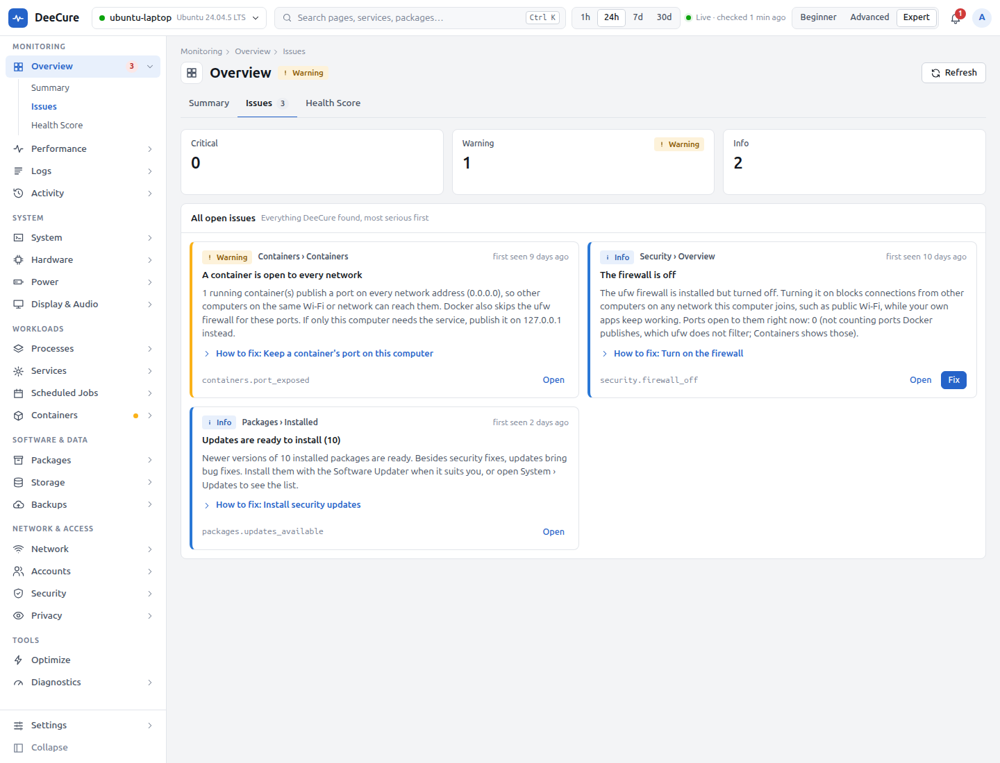

# DeeCure for people new to Linux

[Docs](../../README.md) › [User guide](../README.md) › [Who DeeCure is for](README.md)

**For:** home users, students, parents, and anyone who moved from Windows or macOS and wants Ubuntu to just work.

## What usually goes wrong

- The computer feels slow, and you do not know why.
- A message says the disk is almost full, and you do not know what to delete.
- Updates stop, and nobody notices for months.
- Help online says "open a terminal and type…", and the commands are scary.

## How DeeCure makes it easy

| You want to… | Open | What you get |
| --- | --- | --- |
| Know if everything is fine | **Overview** | A health score from 0 to 100. Green means fine. Each problem says what it means and what to do. |
| Find out why it is slow | **Performance**, or ask **Diagnostics › Performance Check** | The real cause (CPU, memory, disk, or heat) and the app behind it, in one sentence |
| Free up space safely | **Storage › Cleanup** | What fills the disk, and one-click clean-ups of caches, the Trash, old kernels, old snap versions, and logs. Each clean-up lists what it removes before it runs. |
| Keep the computer up to date | **System › Updates** | Waiting updates, security updates first, and whether automatic updates really install |
| Undo a fix | **Activity › DeeCure Actions** (Advanced view) | Every fix DeeCure made, with **Undo** where undo is possible |
| Understand an error | Any page | Plain-English explanations, built in, no internet search needed |

## Fixing a problem, step by step

1. A problem appears on the **Overview**, for example "Main disk is almost full".
2. Click it. DeeCure explains what it means and why it matters.
3. Click **Fix**. A preview lists every step and the space it will free.
4. Untick any step you do not want. Click **Apply**.
5. If a step needs admin rights, Ubuntu's normal password window appears.
6. DeeCure checks that it worked, and keeps an **Undo** where undo is possible.

## Why it feels calm

- **The Beginner view** has only 8 pages, in plain words.
- **No false alarms.** A busy CPU or memory full of cache is normal and never warns. Only real harm does: heat, wear, errors, risk, or a disk that keeps filling.
- **Nothing changes by itself.** DeeCure only reads, unless you click Fix.
- **Notifications only for serious problems**, with quiet hours, and a short weekly summary on Sunday evening.

## Learning Linux along the way

Every service, package, and error has a short explanation. When you are ready, switch to **Advanced** to see logs, services, and scheduled jobs, still explained. The exact commands DeeCure runs are shown in **Expert**, so you can learn them at your own pace.

## Your first 10 minutes

1. Install DeeCure ([Install](../install.md)) and open it.
2. Answer **Yes** to "Are you new to Linux?". You get the Beginner view.
3. Read the **Overview**. Fix anything marked critical first.
4. Open **System › Updates** and install what waits.
5. Open **Settings › Notifications** and pick quiet hours.

---

Next: [Laptop owners](02-laptop-owners.md) · [All roles](README.md)
