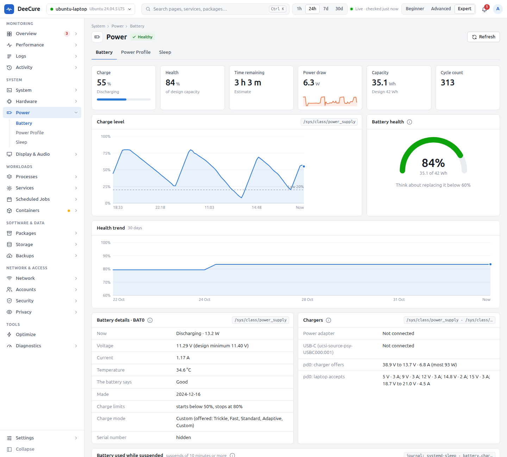

# DeeCure for laptop owners and remote workers

[Docs](../../README.md) › [User guide](../README.md) › [Who DeeCure is for](README.md)

**For:** anyone who works from a laptop: remote and hybrid workers, students carrying it all day, people who travel.

## What usually goes wrong

- The battery lasts less every month, and you do not know if it is worn or just busy.
- The laptop gets hot and loud on your lap.
- It wakes up in the bag and arrives empty.
- It sits on the charger all day, which wears the battery faster.

## How DeeCure makes it easy

| You want to… | Open | What you get |
| --- | --- | --- |
| Know how healthy the battery is | **Power › Battery** | Health in % of its design capacity, charge cycles, temperature, a 30-day health trend, and time left |
| Know what drains it | **Power › Battery › Battery use by app** | Which apps used the battery today, yesterday, or this week, like a phone's battery screen (an estimate, said so) |
| Get more hours from one charge | **Power › Power Profile** | The power mode, and the battery policies Ubuntu applies |
| Make the battery last for years | **Power › Power Profile › Power controls** (Expert view) | Charge limits, such as stop at 80%, from presets or your own numbers, plus turbo, the highest CPU speed on battery, the lid action, and the keyboard backlight. Kept after a restart. |
| Stop it waking in the bag | **Power › Sleep** | Every suspend with its result and how much battery it used. In Expert: every device allowed to wake the laptop, and which one did. |
| Keep it cool and quiet | **Hardware › Sensors** | Each part's temperature against its own limit, fan speeds, and heat slowdowns over 24 hours |
| Check a charger | **Power › Battery** (Expert view) | What a USB-C charger offers, and whether it is too weak for the laptop |

## Advice that fits how you use your laptop

DeeCure's **Optimize** page looks at your real history before it suggests anything:

- **A charge limit** only when the laptop was on the charger most of the last 14 days.
- **A different power mode** only when Power saver runs on the charger, or Performance runs on battery, for a long time.
- **Turbo off on battery** only when the CPU often slowed down from heat while on battery.
- **Power saving for a device** only when that device supports it and has it off. Keyboards, mice, and sound devices are left alone.
- **Wake-ups with the lid closed:** when the laptop woke up 3 or more times in a week while closed, DeeCure names the last device that woke it and points to Power › Sleep.

## Safe to try

Risky power settings are tried for one session first. You keep them only when you click **Keep**. If a setting ever froze the laptop, DeeCure skips it at the next start, so you are never stuck.

## Warnings that matter on a laptop

- **Battery worn:** it holds under 60% of its design charge.
- **Battery too hot:** 45 °C or more while charging, or 60 °C at any time.
- **Charger too weak:** plugged in, but the battery still drains for 10 minutes.
- **Cooling cannot keep up:** the CPU keeps slowing down from heat near its own limit. Short turbo bursts while cool never count.
- **Fan stopped while hot:** a fan reports 0 RPM while the CPU is over 75 °C for 2 minutes.

## Your first 10 minutes

1. Open **Power › Battery**. Note the health %.
2. Switch to the **Expert** view. If the laptop is mostly on the charger, set a charge limit of 80% in **Power › Power Profile › Power controls**.
3. Open **Power › Sleep**. Turn off waking for devices you never use to wake it.
4. Open the **Optimize** page (Expert view) and click **Scan**. Go through what it finds with **Next**.

---

Previous: [New to Linux](01-new-to-linux.md) · Next: [Developers](03-developers.md) · [All roles](README.md)
