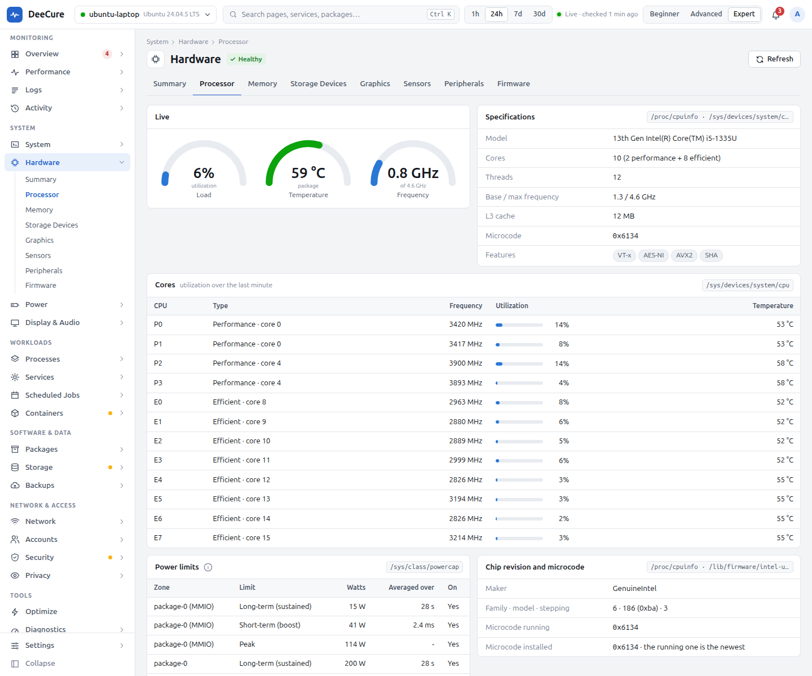

# DeeCure for gamers and creators

[Docs](../../README.md) › [User guide](../README.md) › [Who DeeCure is for](README.md)

**For:** people who play games on Linux, edit video or photos, make music, stream, or work in 3D.

## What usually goes wrong

- A game stutters, and you cannot tell if it is the graphics card, heat, or the CPU.
- Video plays on the CPU instead of the graphics card, so the laptop gets hot.
- The desktop draws in software after an update, and everything feels slow.
- The second graphics card never sleeps and drains the battery.
- The recommended graphics driver is missing.

## How DeeCure makes it easy

| You want to… | Open | What you get |
| --- | --- | --- |
| See how busy the graphics card is | **Performance › GPU** and the **Overview** | GPU use over time next to CPU and memory. AMD and Intel report it; the NVIDIA driver does not, and DeeCure says so instead of guessing. |
| Check the graphics setup | **Hardware › Graphics** | The kernel driver, OpenGL and Vulkan versions, hardware video decoding, and driver checks |
| Get the right driver | **Hardware › Graphics** and **Optimize** | Drivers Ubuntu recommends for your card, and the hardware video driver when it is missing |
| Keep full speed | **Hardware › Peripherals › PCIe links** (Expert view) | Whether the graphics card and the SSD run at their full PCIe link speed and width |
| Stay cool under load | **Hardware › Sensors** and **Hardware › Processor** | Each temperature against the part's own limit, heat slowdowns, fan speeds, and the chip's power limits |
| Pick the power mode | **Power › Power Profile** | Performance, Balanced, or Power saver |
| Check screens and sound | **Display & Audio** | Connected displays, the session type, and sound output and input devices |
| Make room for big games and projects | **Storage** | What fills the disk, and safe clean-ups |

## Improvements the Optimize page can find

Each one is offered only when a measurement shows it is needed:

- **Install the hardware video driver** when the card can decode video but its driver package is missing, so video plays on the graphics card, not the CPU.
- **Let the second graphics card sleep** when it stays awake with nothing using it. If an app holds it open, DeeCure names the app.
- **Install the recommended driver** when a device uses a fallback driver, or none, and Ubuntu recommends one.
- **Clean the fans, or check the cooling** when the CPU often slowed down from heat.

## Warnings that explain stutters and crashes

- **No graphics acceleration:** the desktop draws in software (`llvmpipe`): slow, hot, and high CPU use.
- **Graphics card hung:** a GPU hang or reset in the last 24 hours.
- **Cooling cannot keep up:** the CPU keeps slowing down from heat near its own limit.
- **A part is too hot:** a drive, the graphics card, or the Wi-Fi chip at its own warning temperature.

## Your first 10 minutes

1. Open **Hardware › Graphics**. Check the driver checks are all green.
2. Play or render for a while, then open **Performance › GPU** and **Hardware › Sensors**.
3. Open **Optimize** (Expert view) and click **Scan**.

---

Previous: [Developers](03-developers.md) · Next: [Looking after other PCs](05-looking-after-other-pcs.md) · [All roles](README.md)
