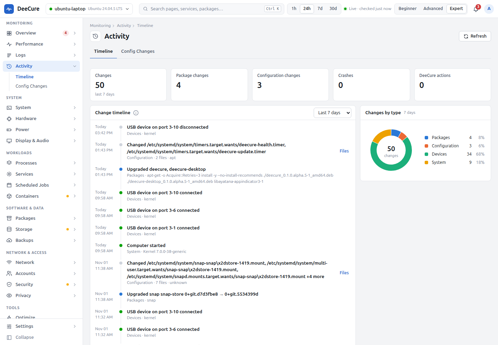

# DeeCure for people who look after other people's computers

[Docs](../../README.md) › [User guide](../README.md) › [Who DeeCure is for](README.md)

**For:** the family member everyone calls when the computer acts up, the person who runs IT in a small office, school, shop, or non-profit, and freelance tech helpers.

## What usually goes wrong

- You hear about a problem only after it has broken something.
- "I didn't change anything", but something did change.
- Backups stopped months ago, and nobody noticed.
- Security updates stopped installing by themselves.
- You fix something by hand, and cannot remember what you did.

## How DeeCure makes it easy

| You want to… | Open | What you get |
| --- | --- | --- |
| Hear about problems early | **Settings › Notifications** | A notification for critical problems, quiet hours (22:00 to 07:00 by default), and a weekly summary every Sunday evening |
| Know what changed | **Activity › Timeline** | Every package install and upgrade (apt, snap, Flatpak), config file change with line-by-line differences, USB device, boot, and crash, for 7, 30, or 90 days |
| Get a report to keep or share | `deecure report --html report.html` | One HTML file with health, problems, what changed, disks, and a tip |
| Check backups | **Backups** | The last Déjà Dup backup and Timeshift snapshot, where they go, and how old they are |
| Keep updates flowing | **System › Updates** and **Security** | Waiting updates, security updates first, and whether automatic updates really still install |
| Fix without guessing | Any problem, then **Fix** | Every step and command shown first, the result checked, and an undo kept |
| See who uses the computer | **Accounts** | People and groups, active sessions, sign-ins per day, and SSH keys |

## Warnings that catch the quiet failures

- **No backups are set up**, or **the last backup is old** (over 35 days).
- **Automatic security updates stopped working:** they are on, but the last good run was days ago.
- **Security updates are waiting.**
- **Disk almost full**, and a forecast "full in about N days" only from real, lasting growth.
- **The drive is wearing out**, read from the drive's own health data.
- **The firewall is off.**

## Safe for the person who uses the computer

- **The Beginner view** shows only 8 calm pages, so the person using the computer is not scared by details.
- **Nothing changes by itself.** Every fix waits for a click and shows its steps.
- **Guard rails you can trust:** an update never removes other packages and keeps changed settings files; a clean-up that would remove the desktop, the network, sudo, or the running kernel is refused; the login screen and the session are never restarted.
- **A record of every fix**, in **Activity › DeeCure Actions** (Advanced view), with undo where it can be undone. You can always answer "what did you change?".

## Good to know

- DeeCure runs on each computer on its own. There is no central dashboard and no remote control. That is part of why nothing leaves the computer.
- DeeCure keeps itself up to date, after an OK by default, or automatically if you choose.

## Your first 10 minutes on someone else's computer

1. Install DeeCure ([Install](../install.md)) and open it.
2. Fix anything critical on the **Overview**.
3. Open **Backups**. If nothing is set up, set up Ubuntu's Backups (Déjà Dup).
4. Open **System › Updates** and make sure automatic updates work.
5. Set the view to **Beginner** before you hand the computer back.

---

Previous: [Gamers and creators](04-gamers-and-creators.md) · Next: [Sysadmins and servers](06-sysadmins-and-servers.md) · [All roles](README.md)
