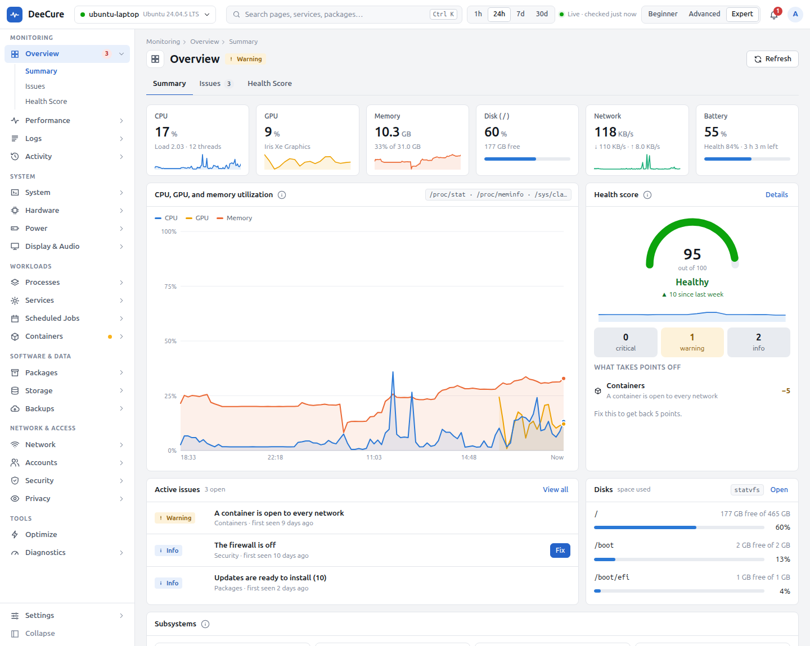

# Who DeeCure is for, and what it does for you

[Docs](../../README.md) › [User guide](../README.md)

DeeCure is one app that looks after your whole Linux computer. It shows how healthy the computer is, tells you early when something is going wrong, explains it in plain English, and fixes it safely, with a preview first and undo after.

This page and the pages below show how it helps different people. Find yourself in the table, then read your page. Each one takes about three minutes.

## Find your page

| You are… | What you mostly want | Your page |
| --- | --- | --- |
| New to Linux, a student, or a family member | A computer that just works, and plain answers when it does not | [New to Linux](01-new-to-linux.md) |
| A laptop owner or remote worker | Longer battery life, less heat and noise, reliable sleep | [Laptop owners](02-laptop-owners.md) |
| A developer, data scientist, or engineer | Every detail of CPU, memory, disks, containers, ports, and the kernel, without ten commands | [Developers](03-developers.md) |
| A gamer, video editor, or 3D artist | Full graphics speed, cool temperatures, the right drivers | [Gamers and creators](04-gamers-and-creators.md) |
| The person who looks after a family or small office PC | Early warnings, a clear report, safe fixes you can undo | [Looking after other PCs](05-looking-after-other-pcs.md) |
| A system administrator | Health, history, and fixes from the terminal, on desktops and servers | [Sysadmins and servers](06-sysadmins-and-servers.md) |
| Security and privacy minded | Updates that really install, a working firewall, nothing exposed, nothing sent away | [Security and privacy](07-security-and-privacy.md) |

## In your field

| Field | How DeeCure helps | Read |
| --- | --- | --- |
| **Home and family** | A calm view, early warnings, and safe fixes, so the family PC keeps working | [New to Linux](01-new-to-linux.md), [Looking after other PCs](05-looking-after-other-pcs.md) |
| **Schools and universities** | Students learn Linux with plain explanations; the lab helper sees what changed and whether updates and backups run | [New to Linux](01-new-to-linux.md), [Looking after other PCs](05-looking-after-other-pcs.md) |
| **Small offices, shops, and non-profits** | Updates that really install, backups that are checked, a report to keep, and fixes with undo, without an IT team | [Looking after other PCs](05-looking-after-other-pcs.md), [Security and privacy](07-security-and-privacy.md) |
| **Software and DevOps** | Containers, ports, services, memory per app, and the kernel in one place, plus the terminal | [Developers](03-developers.md), [Sysadmins and servers](06-sysadmins-and-servers.md) |
| **Data science and machine learning** | Memory pressure, swap, apps killed for memory, GPU use, heat slowdowns during long runs | [Developers](03-developers.md), [Gamers and creators](04-gamers-and-creators.md) |
| **Media, design, music, and gaming** | Graphics drivers, video decoding on the GPU, full PCIe speed, and cool temperatures | [Gamers and creators](04-gamers-and-creators.md) |
| **Remote and travelling work** | Battery health and limits, sleep that does not drain, and power settings that last | [Laptop owners](02-laptop-owners.md) |
| **Law, journalism, finance, and client data** | A locked-down machine, a working firewall, no exposed ports, app permissions in view, and nothing sent away | [Security and privacy](07-security-and-privacy.md) |
| **IT operations** | Health, history, reports, and fixes from the terminal, on desktops and servers | [Sysadmins and servers](06-sysadmins-and-servers.md) |

## The five things DeeCure does for everyone

1. **Shows how the computer is doing.** One health score from 0 to 100, the problems behind it, and how busy the CPU, graphics, memory, disk, and network are.
2. **Warns early, without false alarms.** It judges each part against its own limits, such as the temperature a drive says it can take. Normal use, like a busy CPU or memory full of cache, never warns. 55 warnings, and you can change any of them.
3. **Explains in plain English.** What a service does, what an error in the log means, why the computer is slow. Over 130 built-in explanations, shown where you need them.
4. **Fixes safely.** 47 fixes. Each one shows its steps before it runs, asks for your password only for admin steps, checks the result, and keeps an undo.
5. **Improves only what needs it.** The Optimize page scans the computer and offers an improvement only when a measurement shows it helps. No "speed-up tips" that do nothing.

## Problems people bring to DeeCure

| "My computer…" | Where DeeCure answers it |
| --- | --- |
| …is slow | **Diagnostics › Performance Check** names the cause (CPU, memory, disk, or heat) and the app behind it |
| …is hot and loud | **Hardware › Sensors** shows each part's temperature against its own limit, and fan speeds |
| …battery dies fast | **Power › Battery** shows battery health and which apps used the battery |
| …disk is almost full | **Storage** shows what fills it, when it will be full, and one-click clean-ups |
| …broke after an update | **Activity › Timeline** shows every package, setting file, and device change |
| …wakes up in my bag | **Power › Sleep** shows what woke it and which devices are allowed to |
| …might not be safe | **Security** checks updates, the firewall, open ports, and SSH settings |
| …feels like it could be better | **Optimize** scans it and lists only what really helps |

## Start in five minutes

1. Install it with one command on Ubuntu 24.04 or 26.04 ([Install](../install.md)).
2. Open **DeeCure** from the app menu. It asks if you are new to Linux and picks the right view for you.
3. Look at the **Overview**. Green means fine. Anything else is listed with what it means.
4. Open a problem, read **How to fix**, and click **Fix**. You see every step first.
5. Leave it running. It checks the computer every minute and tells you only when something matters.

## Three views, one app

| View | For | What you see |
| --- | --- | --- |
| **Beginner** (default) | Anyone new to Linux | 8 calm pages in plain words |
| **Advanced** | People who know their computer | Every page: logs, services, jobs, containers, network, accounts |
| **Expert** | People who want every detail | Also the data sources, exact commands, deep hardware data, and Optimize |

Switch at any time from the top bar. Nothing is lost when you switch.

## What every user can count on

- **Private.** Everything stays on your computer. No account, no cloud, no tracking. The only connection is a check for DeeCure updates, which you can turn off.
- **Safe.** About 80% of DeeCure works without a password. It never changes anything unless you ask.
- **Light.** About 0.1% CPU and about 21 MB of memory when idle.
- **Free.** Open source under the Apache-2.0 license.

DeeCure is in pre-release today, for Ubuntu 24.04 and 26.04. A built-in assistant is planned and not here yet.

---

[User guide](../README.md) · [Using DeeCure](../using-deecure.md) · [Install](../install.md)
