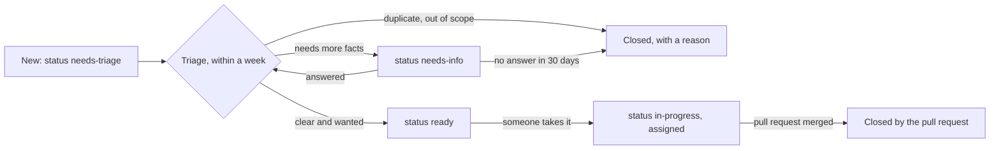

# Issues and labels

[Docs](../README.md) › [Contributing](README.md)

Issues are where work starts. A clear issue saves everyone time.

## Before you open one

- **Security problem?** Do **not** open an issue. Report it privately: [SECURITY.md](../../SECURITY.md).
- **A question or an idea to discuss?** Use [Discussions](https://github.com/krisskad0/DeeCure/discussions), not an issue.
- Search open and closed issues first; add a comment or a 👍 to an existing one instead of a duplicate.

## Kinds of issues

Use the templates (**New issue** on GitHub); they ask for what is needed.

| Template | Use it for | Must include |
| --- | --- | --- |
| Bug report | Something does not work, or shows wrong data | DeeCure version (`deecure --version`), Ubuntu version, steps, what you expected, what happened, logs if any |
| Feature request | Something new, or a change in behavior | The situation and the problem, not only the solution you imagine |

## How an issue moves

- **Triage** is done by a triager or maintainer: add a `type`, an `area`, and a `priority` label, then `ready` or `needs-info`.
- **Taking an issue:** comment, and a maintainer assigns you. An assigned issue with no activity for 30 days may be given to someone else.
- **Closing:** a pull request with `Closes #123` closes the issue when it merges. Every other close gets a short reason.

## Labels

Every issue gets one label of each group: type, area, priority, and status. Maintainers keep them in [.github/labels.yml](../../.github/labels.yml) and apply them with `scripts/sync-labels.sh`.

| Group | Labels | Meaning |
| --- | --- | --- |
| Type | `type: bug`, `type: feature`, `type: docs`, `type: security`, `type: chore` | What kind of work |
| Area | `area: agent`, `area: app`, `area: cli`, `area: helper`, `area: rules-kb`, `area: packaging`, `area: ci`, `area: docs` | Which part of DeeCure |
| Priority | `priority: critical`, `priority: high`, `priority: normal`, `priority: low` | Critical: data loss, a security hole, or the app does not start; fixed before anything else |
| Status | `status: needs-triage`, `status: needs-info`, `status: ready`, `status: in-progress`, `status: blocked` | Where it stands |
| Help | `good first issue`, `help wanted` | Good for newcomers; maintainers would welcome help |
| Pull requests | `needs-two-reviews`, `breaking-change`, `release-blocker` | Added by maintainers on pull requests that need extra care |

## Milestones

Each planned release is a milestone, such as `0.2.0`. A maintainer adds an issue to a milestone when it must be in that release. Issues without a milestone are done when someone has time.

---

← Previous: [First contribution](01-first-contribution.md) · [Contributing](README.md) · Next: [Branches and releases](03-branches-and-releases.md) →
