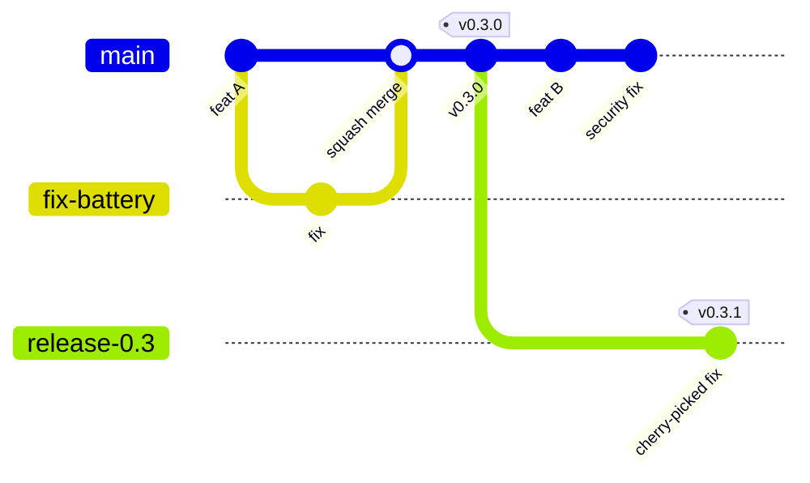

# Branches and releases

[Docs](../README.md) › [Contributing](README.md)

DeeCure uses one main branch, short-lived work branches, and release branches only when an older version needs fixes. This keeps the history simple and every release traceable.

## The branches

| Branch | Who writes to it | How | Protected |
| --- | --- | --- | --- |
| `main` | Nobody directly | Only through reviewed pull requests, squash merged by a maintainer | Yes: no direct push, no force push, no deletion, CI must pass |
| `release/<major>.<minor>` (such as `release/0.3`) | Nobody directly | Cut from a tag by the release manager; fixes arrive by pull request | Yes: same rules as `main`, and only maintainers create them |
| Work branches (`feat/…`, `fix/…`) | The person working on it | In your fork. Maintainers may use the main repository. | No. Deleted after merge. |



In the drawing, `fix-battery` stands for a work branch such as `fix/battery-health`, and `release-0.3` for `release/0.3`.

## Branch names

`<type>/<short-description>`, lower case, words joined with `-`:

| Type | Example |
| --- | --- |
| `feat/` | `feat/disk-forecast` |
| `fix/` | `fix/battery-health-nan` |
| `docs/` | `docs/install-guide` |
| `test/`, `refactor/`, `perf/`, `ci/`, `chore/` | `ci/cache-node-modules` |

Add the issue number when there is one: `fix/123-battery-health`.

## Keeping your branch up to date

Rebase on the newest `main` instead of merging `main` into your branch:

```bash
git fetch upstream
git rebase upstream/main
git push --force-with-lease
```

Force-pushing **your own work branch** is fine. Force-pushing `main`, a release branch, or a tag is blocked for everyone.

## Versions and tags

- [Semantic Versioning](https://semver.org/): `MAJOR.MINOR.PATCH`. While on `0.x`, a minor version may break things; it is written in the CHANGELOG.
- Pre-releases: `0.3.0-alpha.1`, `0.3.0-beta.1`, `0.3.0-rc.1`.
- Every release is a tag `v<version>` on `main` (or on a release branch for a patch). **Only the release manager creates tags.** Tags are never moved or deleted; a broken release gets a new version.
- Pushing a tag starts the release workflow: build, test, checksums, and the GitHub Release. Pre-releases publish at once; stable releases are drafts until the release manager publishes them ([Release process](../06-packaging/release-process.md)).

## Release branches and hotfixes

A release branch is created only when an older version needs a fix while `main` has moved on:

1. The release manager creates `release/0.3` from the tag `v0.3.0`.
2. Fix it on `main` first, by a normal pull request.
3. Cherry-pick the fix into a pull request against `release/0.3`: `git cherry-pick -x <commit>`.
4. After it merges, the release manager tags `v0.3.1` on `release/0.3`.

Only security fixes and serious bugs go to release branches. A security fix is prepared in a private [security advisory](../../SECURITY.md) fork first, and becomes public with the release.

---

← Previous: [Issues and labels](02-issues-and-labels.md) · [Contributing](README.md) · Next: [Pull requests and review](04-pull-requests-and-review.md) →
