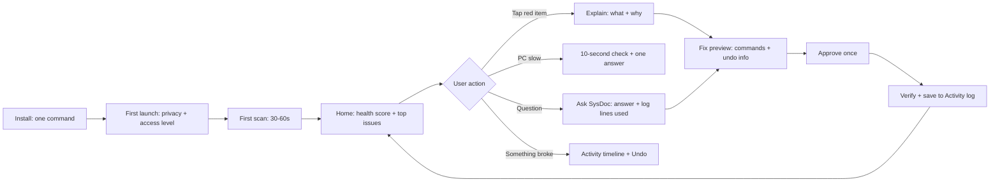
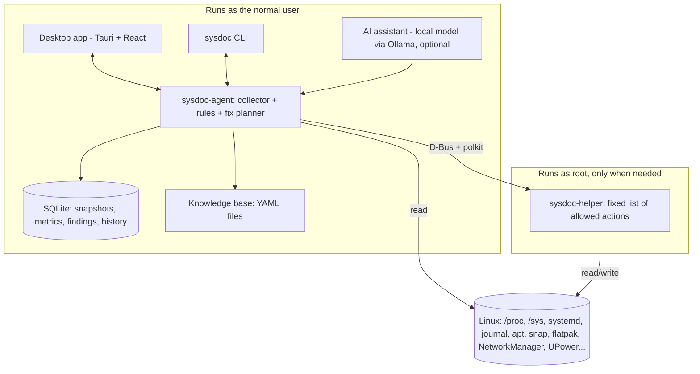

# SysDoc: Implementation Plan and User Journey

As of Oct 22, 2026 · "SysDoc" is a working name (check it is free before launch) · Companions: `linux-system-insights.md` (what can be checked) and `sysdoc-dashboard.html` (clickable UI prototype)

---

## 1. The idea in one line

SysDoc is a **family doctor for your Linux computer**. It checks everything, explains what it finds in plain English, and fixes problems safely with one click and an undo button.

Think of it this way:

- **Cockpit** is like a hospital control panel. It is powerful, but you need to be a nurse to use it.
- **SysDoc** is like a good family doctor. It says "your disk is almost full, here is why, and here is the safe fix."

---

## 2. Who it is for

| Person | Situation | What they need from SysDoc |
| --- | --- | --- |
| **Riya, student, new to Ubuntu** | Laptop feels slow, battery dies fast, scared of the terminal | One health score, simple answers, safe one-click fixes |
| **Arjun, developer** | Docker and old kernels filling the disk, many cron jobs, VPNs | Fast full picture, cleanup, scheduled-jobs calendar, Expert mode |
| **Meena, small office admin** | Looks after 5 shared Ubuntu PCs, no IT team | Clear warnings, security checks, history of "what changed" |

Start with Riya and Arjun. Meena (many machines) comes in a later phase.

---

## 3. Product principles

These five rules decide every design question.

1. **Explain, don't just show.** Every item has a one-line meaning in plain English.
2. **Safe by default.** Every fix shows the exact command first, and keeps an undo point where possible.
3. **Honest.** If something cannot be checked, SysDoc says "your hardware does not report this", not a fake value.
4. **Private.** Everything stays on the computer. Nothing goes to the internet unless the user turns it on.
5. **Light.** It should never be the reason the PC is slow.

---

## 4. User journey (step by step)

### 4.1 Install

1. The user finds SysDoc on the website or in a blog post.
2. They copy one command:
   ```bash
   curl -fsSL https://<site>/install.sh | sudo bash
   ```
   This adds the SysDoc apt repository and installs the `.deb` package. A normal `.deb` download is offered too.
3. After install, SysDoc appears in the app menu.

> **Real-life example:** Riya follows a YouTube tip, pastes one command, and enters her password once. Two minutes later SysDoc is in her app list.

### 4.2 First launch (3 short screens)

1. **Welcome:** "SysDoc checks your computer and explains problems in simple words."
2. **Privacy promise:** "Everything stays on this computer. No account. No data sent anywhere."
3. **Choose access level:**
   - **Basic (no password):** sees about 80% of insights.
   - **Full (recommended):** approves the SysDoc helper once with the admin password. This unlocks disk health, firewall, all users' cron jobs, and similar items.

The user can switch the level later in Settings.

### 4.3 First scan (about 30-60 seconds)

1. A progress screen fills in category by category: "Checking hardware… Checking apps… Checking security…"
2. Results appear as soon as each category finishes, so there is no blank waiting.
3. The deep disk-usage scan keeps running quietly in the background and finishes later.

### 4.4 Home screen (Overview › Summary)

The app opens on a dashboard, not a list of cards. See `sysdoc-dashboard.html` for the clickable version.

```
┌ Top bar: SysDoc · machine picker · search (Ctrl K) · 1h/24h/7d/30d · Beginner/Expert · bell ┐
├──────────┬──────────────────────────────────────────────────────────────────────────────────┤
│ Sidebar  │ Monitoring › Overview                       [Refresh] [Export]                   │
│ (pages + │ Summary | Issues (8) | Health Score                                             │
│ sub-     ├──────────────────────────────────────────────────────────────────────────────────┤
│ pages)   │ [Health 82/100] [CPU 12%] [Memory 5.9 GB] [Disk 94%] [Network 1.2 MB/s] [Battery]│
│          │ ┌ CPU & memory chart (time range) ──────────┐ ┌ Subsystems (status list) ┐      │
│          │ └───────────────────────────────────────────┘ └──────────────────────────┘      │
│          │ ┌ Active issues table (Resolve / Inspect) ──┐ ┌ Health score gauge ──────┐      │
│          │ ┌ Disk donut ┐ ┌ Top processes ┐ ┌ System facts ┐                             │
│          │ ┌ Recent activity timeline ┐ ┌ Errors-by-hour heatmap ┐                         │
└──────────┴──────────────────────────────────────────────────────────────────────────────────┘
```

- **Stat tiles** at the top show the key number for each area, with a sparkline or usage bar. Clicking a tile opens that page.
- **Status colors** are fixed: green = Healthy, yellow = Warning, red = Critical, blue = Info, grey = Unknown. Every color comes with an icon and a word, so it never relies on color alone.
- **Active issues** is a table. Each row has one action button (Resolve, Inspect, Install, View).
- **The time range** in the top bar (1h, 24h, 7d, 30d) redraws every chart on every page.

### 4.4.1 Navigation and page structure

Each insight category is its own page. Each page has sub-pages, shown as tabs under the page title and as a tree in the sidebar. The page names follow common Linux and admin-tool terms.

| Group | Page | Sub-pages (tabs) |
| --- | --- | --- |
| Monitoring | Overview | Summary, Issues, Health Score |
| Monitoring | Performance | CPU, Memory, Disk I/O, Network, GPU, Pressure (PSI) |
| Monitoring | Logs | Journal, Errors, Crashes, Kernel, Boots |
| Monitoring | Activity | Timeline, Package History, Config Changes, Device Events, SysDoc Actions |
| System | System | Overview, Boot, Updates, Kernel, Time & Locale |
| System | Hardware | Summary, Processor, Memory, Storage Devices, Graphics, Sensors, Peripherals, Firmware |
| System | Power | Battery, Power Profile, Sleep |
| System | Display & Audio | Displays, Audio |
| Workloads | Processes | All Processes, Top Consumers |
| Workloads | Services | System Services, User Services, Startup Applications |
| Workloads | Scheduled Jobs | Calendar, Cron, Systemd Timers, Anacron, At Jobs |
| Workloads | Containers | Containers, Images, Volumes, Virtual Machines |
| Software & Data | Packages | Installed, Sources, Cleanup, Permissions |
| Software & Data | Storage | Overview, Filesystems, Disk Usage, Cleanup |
| Software & Data | Backups | Backup Jobs, System Snapshots, Restore Points |
| Network & Access | Network | Interfaces, Connections, Open Ports, Firewall, DNS & VPN, Traffic |
| Network & Access | Accounts | Users, Groups, Sessions, Login History, SSH Keys |
| Network & Access | Security | Overview, Vulnerabilities, Hardening, File Integrity, Malware Scan |
| Network & Access | Privacy | Device Access, App Permissions, Privacy Settings |
| Tools | Diagnostics | Performance Check, Network Test, Hardware Tests |
| Tools | Assistant | Chat |
| (footer) | Settings | General, Access, Notifications, Assistant, Data, About |

That is 22 pages and 91 sub-pages in total.

**Every page uses the same layout:**

1. Breadcrumb (Group › Page › Sub-page).
2. Page title, status badge, and page actions (for example Free up space, Refresh, Export).
3. Tabs for the sub-pages, with a count badge where useful (Issues 8, Updates 12).
4. A 12-column grid of panels. Each panel has a title, an optional info tooltip, the data source (shown in Expert mode), and its own actions.

### 4.4.2 UI components

| Component | Used for | Example |
| --- | --- | --- |
| Stat tile | One headline number + sparkline or bar | Memory 5.9 GB, 78% of 7.6 GB |
| Line / area chart (with hover crosshair) | Values over time | CPU and memory utilization |
| Stacked area chart | Parts of a total over time | CPU by User / System / I/O wait |
| Bar chart | Counts per period or item | Boot time for the last 10 boots |
| Horizontal bar list | Ranking | Largest folders, slowest boot units |
| Donut chart | Share of a whole | Disk usage by type |
| Gauge | One value against a limit | Health score, battery health, temperatures |
| Heatmap (day × hour) | When things happen | Errors by hour, job runs by hour |
| Allocation bar | Space split on one disk | Home / Apps / System / Reclaimable / Free |
| Swim-lane timeline | Upcoming scheduled runs | Next 24 hours of cron and timer runs |
| Lifecycle bar | Support window | Ubuntu 24.04 released → support ends |
| Data table | Lists of records | Services, processes, packages, ports |
| Key-value panel | Facts about one thing | OS version, kernel, BIOS |
| Checklist | Pass / warn / fail checks | Security posture, filesystem checks |
| Activity timeline | Changes in order | Package installs, config edits |
| Alert banner | One important problem with an action | "Port 5432 bypasses the UFW firewall" |
| Detail drawer | Inspect a row or run a fix | bluetooth.service crash details |
| Command palette (Ctrl K) | Jump to any page, service, package or job | Type "docker" |
| Notifications popover | Open issues from anywhere | Bell icon in the top bar |
| Toggle, radio card, select | Settings | Power profile, access level |

**Data tables** all support the same features: sort by any column, search, filter chips, paging, row selection with a bulk action, and click-to-inspect.

### 4.5 Fixing a problem (the core flow)

**Example:** "Disk 94% full."

1. **Tap the red item.** SysDoc shows:
   - What it means: "Your main disk is almost full. Apps may crash and updates may fail."
   - Why it happened: "Old snap versions 9 GB · Docker images 4 GB · Trash 2 GB."
2. **Tap Fix.** A preview screen lists each step:
   - "Remove 6 old snap versions (9 GB). Command: `snap remove <name> --revision=<n>`. Undo: No, but these are old copies; your current apps stay."
   - "Empty Trash (2 GB). Undo: No. Files in Trash will be gone."
   - The user can untick any step.
3. **Tap Apply.** If a step needs admin rights, the normal Ubuntu password box appears once.
4. **SysDoc checks the result:** "Done. Disk now 79% full. Health 82 → 90."
5. The action is saved in **Activity › SysDoc Actions**, with an Undo button where undo is possible.

### 4.6 "Why is my PC slow?" (Diagnostics › Performance Check)

1. The user taps the button while the PC feels slow.
2. SysDoc takes a 10-second look at CPU, RAM, memory pressure, disk activity, temperature, and the top apps.
3. It answers in one sentence plus one action:
   - "Chrome is using 6.1 GB of your 8 GB RAM (42 tabs). Closing unused tabs will help."
   - "Your CPU is at 95 °C and slowing itself down. Check that the air vents are not blocked."
4. Each answer has a **Show details** link for experts.

### 4.7 Ask SysDoc (Assistant › Chat)

1. The user types or says: "Why did my laptop restart last night?"
2. SysDoc looks at the boot list and the last log lines before the restart.
3. It answers: "Your laptop did not shut down cleanly at 2:14 AM. The last logs show the battery at 1%. It most likely ran out of power." It also shows the 3 log lines it used.
4. If the AI suggests a fix, the fix still goes through the normal preview → approve → undo flow. The AI can never run commands directly.

### 4.8 Everyday use

- SysDoc runs quietly in the background. It shows a small tray icon only if the user wants one.
- **Notifications** appear only for serious things, such as "Disk will be full in about 3 days" or "SSD health dropped to 15%".
- A **weekly report** (optional) gives the health trend, what changed, and one tip.

### 4.9 Something broke after a change

**Example:** Wi-Fi stopped working today.

1. The user opens **Activity › Timeline** (the "what changed" timeline).
2. They see: "Yesterday 6:40 PM: kernel updated 6.8 → 6.11" and "Yesterday 6:41 PM: Wi-Fi driver module changed".
3. SysDoc suggests: "Start once with the previous kernel from the boot menu. Here is how."
4. If SysDoc itself made a change, there is an **Undo** button right there.

### 4.10 Growing into an expert

- **Beginner mode** (default) shows the dashboard with plain labels, info tooltips, and one-click fixes.
- **Expert mode** adds the data source on every panel (for example `ss -tulpn`), extra table columns (MAC address, swap per process, threads), and full logs.
- Every fix always shows its exact command before it runs, so beginners learn real Linux commands slowly.

### 4.11 Uninstall

- The user runs `sudo apt remove sysdoc` or clicks Uninstall in Settings.
- SysDoc asks: "Also delete history and settings?"
- The admin helper and its permissions are removed completely.

### 4.12 Journey at a glance



---

## 5. Screens list

The full page and sub-page tree is in section 4.4.1. These are the screen types the UI team builds:

| # | Screen type | Purpose | Where in the prototype |
| --- | --- | --- | --- |
| 1 | Onboarding (3 steps) | Welcome, privacy, access level | First launch only (not in prototype) |
| 2 | First scan | Live progress by category | First launch only (not in prototype) |
| 3 | Overview dashboard | Stat tiles, charts, issues, subsystems | Overview › Summary |
| 4 | Category page (x20) | Page header, tabs, panel grid | Every sidebar page |
| 5 | Data table page | Searchable, sortable records | Processes, Services, Packages, Logs › Journal |
| 6 | Detail drawer | Inspect one row: facts, logs, actions | Click any row in Processes or Services |
| 7 | Fix drawer | Steps, commands, undo type, password, progress, result | Storage › Free up space |
| 8 | Diagnostics runner | Step-by-step check with a result | Diagnostics › Performance Check |
| 9 | Assistant chat | Questions with sources shown | Assistant › Chat |
| 10 | Activity timeline | Changes in order, with Undo | Activity › Timeline, SysDoc Actions |
| 11 | Scheduled jobs calendar | Next 24 hours lanes + run heatmap | Scheduled Jobs › Calendar |
| 12 | Settings forms | Toggles, selects, radio cards | Settings |
| 13 | Command palette | Search across everything | Ctrl K |

---

## 6. Architecture



### 6.1 Components

| Component | Runs as | Job |
| --- | --- | --- |
| **sysdoc-agent** | Normal user (systemd user service) | Collects data, runs rules, plans fixes, stores history, serves the UI |
| **sysdoc-helper** | Root, started by D-Bus only when called | Runs a fixed list of allowed admin actions, and reads admin-only data |
| **Desktop app** | Normal user | All screens; talks to the agent over a local socket |
| **CLI** | Normal user | `sysdoc status`, `sysdoc slow`, `sysdoc fix <id>`, and JSON output for scripts |
| **Knowledge base** | Files shipped with the app | Plain-English meanings of services, errors, ports, and packages |
| **AI assistant** | Normal user, optional | Answers questions using only read-only data from the agent |

### 6.2 Tech stack (and why)

| Part | Choice | Why |
| --- | --- | --- |
| Agent and helper | **Rust** | Small memory use, no runtime to install, safe for a root helper. Go is a fine alternative if the team knows it better. |
| D-Bus | `zbus` crate | Talks to systemd, NetworkManager, UPower, BlueZ, and the helper |
| Journal | sd-journal bindings | Fast reading and filtering of logs without spawning `journalctl` |
| Storage | **SQLite** (WAL mode) | One file, no server, easy backup |
| Desktop UI | **Tauri v2 + React + TypeScript** | Much lighter than Electron, and uses web skills. Svelte is fine if preferred. |
| Charts | Lightweight chart library (e.g. uPlot) | Fast with long time series |
| AI | **Ollama** with a small local model (about 3-8B) | Private and offline. A cloud model only with explicit opt-in. |
| Rules and KB | **YAML** files | Easy for contributors to add checks without writing code |

---

## 7. How each part works

### 7.1 Collector (sysdoc-agent)

The agent reads data on a schedule. Heavy work runs only when the PC is idle, with low priority (`nice` and `ionice`).

| What | How often | Source examples |
| --- | --- | --- |
| Live metrics (CPU, RAM, pressure, temperature, network) | Every 2s while the UI is open; every 60s in the background | /proc, /sys, hwmon |
| Services and timers state | On change (D-Bus signals) plus every 5 min | systemd over D-Bus |
| Logs (errors, crashes, OOM kills) | Live follow | systemd journal |
| Apps and packages | On change (watch dpkg log, snap and flatpak) plus daily | dpkg, snap, flatpak |
| Config and jobs changes | On change (inotify on /etc, cron folders, autostart) | File watcher |
| Hardware inventory | At start and on device plug events | udev, /sys, lspci, lsusb |
| Disk health (SMART) | Daily (through the helper) | smartctl, nvme |
| Full disk-usage scan | Weekly or on demand, when idle | Directory walk with cache |
| Security checks | Daily | Rules engine |

Every collector has an **adapter** interface. Ubuntu/Debian adapters come first; Fedora, Arch, and others plug in later.

### 7.2 Admin helper (sysdoc-helper)

The helper is the only part that runs as root, so it is kept small and strict.

1. It is **started by D-Bus only when needed**, and exits after 2 minutes of no use.
2. It offers a **fixed list of actions**. It never runs a free-form command. Examples:
   - `ReadSmart(device)`, `ReadFirewall()`, `ListAllCrontabs()`, `ReadShadowStatus()`
   - `CleanAptCache()`, `VacuumJournal(size)`, `RemoveSnapRevision(name, rev)`
   - `RestartService(unit)`, `DisableService(unit)`, `EnableFirewall()`, `RemoveOldKernels(keep=2)`
3. Each action has a **polkit rule**. Read actions use `auth_admin_keep`, so one password covers a few minutes. Risky write actions ask every time.
4. The helper checks every input (for example, a service name must exist) and writes every call to an audit log.

### 7.3 Storage (SQLite)

| Table | Holds |
| --- | --- |
| `snapshot` | Inventory at a point in time (apps, services, users, jobs, ports, hardware) |
| `metric` | Time series (CPU, RAM, temperature, disk, battery) |
| `event` | Things that happened (install, update, crash, OOM, login fail, device plugged) |
| `finding` | Current problems and warnings from rules, with severity and status |
| `fix_run` | Each fix applied: steps, commands, result, undo data |
| `setting` | User settings |

**Retention:** 1-minute data is kept 7 days, 15-minute averages 90 days, and daily averages 2 years. The target database size is under 200 MB.

### 7.4 Rules engine

Every check is a small YAML rule. That makes it easy to add checks and to review them.

```yaml
id: storage.root_almost_full
category: storage
severity:
  warning: "root.used_percent >= 85"
  critical: "root.used_percent >= 93"
title: "Main disk is almost full"
explain: >
  Your main disk has only {root.free_gb} GB left. When it is full,
  apps can crash and updates can fail.
cause_hint: storage.cleanable_breakdown   # shows what is using space
fixes:
  - action: storage.clean_apt_cache
  - action: storage.remove_old_snap_revisions
  - action: storage.empty_trash
learn_more: kb/storage/disk-full.md
```

A fix action looks like this:

```yaml
id: storage.remove_old_snap_revisions
needs_admin: true
helper_call: RemoveSnapRevision
preview_command: "snap remove {name} --revision={rev}"
undo: none
undo_note: "These are old copies. Your current apps are not touched."
verify: "snap list --all shows no disabled revisions"
```

### 7.5 Knowledge base

The knowledge base is plain YAML files, organized by type. These files are what make SysDoc friendlier than Cockpit.

```yaml
# kb/services/cups.yaml
name: cups.service
plain: "Printing service. Sends documents to printers."
safe_to_disable: "Yes, if you never print."
if_failed: "Printing will not work. Other things are not affected."
```

```yaml
# kb/errors/ext4-error.yaml
match: "EXT4-fs error"
plain: "The disk's file system reported damage."
severity: critical
next_step: "Back up important files now, then run a disk check from recovery mode."
```

- The first release ships with entries for the most common services, errors, and ports on Ubuntu.
- Contributors can add entries through pull requests.
- Anything not covered falls back to the AI, which labels its answer "AI explanation: may be wrong".

### 7.6 Health score

1. Each category starts with its share of the score (for example, Storage 15, Security 15, Hardware 15).
2. Each open finding deducts points: critical −15, warning −5, info 0. A category can never go below 0.
3. The total is out of 100, with a breakdown shown on tap: "Storage −10 (disk 94% full)".
4. The score only uses findings the system can actually check, so a missing sensor does not lower it.

### 7.7 Fix engine and undo

Every fix follows the same five steps:

1. **Plan:** list the steps, commands, admin needs, and undo type.
2. **Preview:** the user sees everything and can untick steps.
3. **Protect:** SysDoc saves an undo point first (see table).
4. **Apply:** it runs the steps (admin steps through the helper) and stops on the first failure.
5. **Verify:** it re-runs the rule. If the problem is still there, it says so honestly.

| Undo type | Meaning | Example |
| --- | --- | --- |
| **Full undo** | SysDoc can put it back exactly | Disable a service → re-enable; edit a config → restore the saved copy |
| **No undo needed** | The thing rebuilds itself | Clear apt cache, thumbnails |
| **No undo** | It is gone for good, and the user is warned clearly | Empty Trash, remove old snap versions |
| **System snapshot** | Used for big changes when Timeshift or Btrfs is present | Remove old kernels |

### 7.8 AI assistant

1. **Local first:** it uses Ollama with a small model and is off until the user turns it on.
2. **Read-only tools:** the AI can call agent functions like `get_findings`, `get_events(since)`, `get_boot_list`, and `get_logs(filter)`. It cannot run commands.
3. **Grounded answers:** each answer shows the data or log lines it used.
4. **Fixes go through the fix engine:** the AI can only suggest a known fix action ID, which then goes through preview and approval.
5. **Cloud option:** when enabled, SysDoc removes usernames, hostnames, IPs, and serial numbers before sending.

### 7.9 Notifications

- **Critical** findings notify right away: disk almost full, SSD failing, overheating, and similar.
- **Warnings** wait for the weekly summary.
- Quiet hours are supported, and the same alert never repeats within 24 hours.

### 7.10 CLI

```bash
sysdoc status            # health score + top issues
sysdoc slow              # "why is my PC slow?"
sysdoc show storage      # one category
sysdoc jobs              # all scheduled jobs, next run times
sysdoc history --since 7d
sysdoc fix storage.root_almost_full --preview
sysdoc report --html report.html   # full report to share
sysdoc status --json     # for scripts and servers
```

The CLI also makes SysDoc usable on servers with no desktop.

---

## 8. Security and privacy of SysDoc itself

1. **No free-form root commands.** The helper accepts only listed actions with checked inputs.
2. **No network by default.** The agent opens no ports. The UI talks over a local socket that only this user can access.
3. **Signed updates.** Packages and knowledge-base updates are signed.
4. **Audit log.** Every admin action is logged with time, user, and result.
5. **Telemetry off by default.** If added later, it is opt-in, anonymous, and documented.
6. **Code review rule.** Any change to the helper needs two reviewers.

---

## 9. Packaging and install

| Format | Use | Note |
| --- | --- | --- |
| **.deb + apt repository** | Main channel for Ubuntu and Debian | Installs the agent, helper, polkit policy, and app |
| **Install script** | One-command setup | Adds the repository and installs the `.deb` |
| AppImage (UI only) | Optional, later | The agent and helper still need the `.deb` |
| Snap / Flatpak | **Not for the core** | Their sandboxes block the system access SysDoc needs |
| RPM, Arch (AUR) | Later phases | With the distro adapters |

---

## 10. Performance budget

| Measure | Target |
| --- | --- |
| Agent CPU when idle | Under 1% |
| Agent RAM | Under 60 MB |
| Desktop app RAM (open) | Under 200 MB |
| First useful results | Under 10 seconds |
| Full first scan (without deep disk scan) | Under 60 seconds |
| Database size | Under 200 MB |

The project should add an automated check that fails the build if these limits are broken.

---

## 11. Repository structure

```
sysdoc/
├── agent/            # Rust: collectors, rules engine, fix planner, API
│   ├── collectors/   # cpu, memory, disk, battery, services, jobs, apps, network...
│   ├── adapters/     # ubuntu/, fedora/, arch/
│   ├── rules/        # rule loader + evaluator
│   └── fixes/        # fix planner, undo store
├── helper/           # Rust: root helper, D-Bus interface, polkit policy
├── app/              # Tauri + React desktop app
├── cli/              # sysdoc command
├── kb/               # knowledge base YAML (services, errors, ports, packages)
├── rules/            # rule YAML files by category
├── packaging/        # debian/, install.sh, apt repo scripts
└── tests/
    ├── fixtures/     # captured /proc, /sys, journal samples from real machines
    └── vm/           # VM test matrix scripts
```

---

## 12. Testing

1. **Fixture tests:** capture real `/proc`, `/sys`, journal, and command outputs from many machines, then run collectors and rules against them offline.
2. **VM matrix:** run the full app on supported Ubuntu LTS releases, desktop and server, in VMs on every release.
3. **Hardware lab:** test on a few real laptops (Intel, AMD, NVIDIA, ThinkPad, budget laptop) because sensors and batteries differ.
4. **Fix safety tests:** each fix must pass apply → verify → undo in a VM before it ships.
5. **Beginner tests:** 5 non-technical users try three tasks ("free up space", "why is it slow", "what changed"). Measure success without help.

---

## 13. Roadmap

Durations are rough estimates for a team of 2-3 engineers.

| Phase | What ships | Rough time |
| --- | --- | --- |
| **0. Foundations** | Agent skeleton, SQLite, 5 collectors, CLI `status`, fixture tests | 3-4 weeks |
| **1. MVP: see and understand** | All Yes-status insights from the category list, home screen, category pages, KB for common items, health score, jobs calendar | 8-10 weeks |
| **2. Fix safely** | Helper + polkit, Admin-status insights, fix engine with preview, verify, and undo, first 20 fixes | 6-8 weeks |
| **3. History and trends** | What-changed timeline, trends, predictions ("disk full in N days"), notifications, weekly report | 5-6 weeks |
| **4. Ask SysDoc** | Local AI assistant with read-only tools, "Why did my PC restart?" | 4-6 weeks |
| **5. Reach** | Fedora and Arch adapters, KDE support, server web mode, multi-PC view for small offices | Ongoing |

**Launch the public beta after Phase 2.** Before that, the app can show problems but cannot fix them, and "safe fixes" is the main promise.

---

## 14. Success metrics

| Metric | Target |
| --- | --- |
| Time from install to first insight | Under 2 minutes |
| Beginners who complete "free up space" without help | 80% or more |
| Findings with a plain-English explanation | 95% or more |
| Fixes that verify as successful | 95% or more |
| Fixes undone by users | Under 5% (a higher rate means a bad fix) |
| Users still active after 30 days | 40% or more |

---

## 15. Risks and how to handle them

| Risk | What could happen | How to handle it |
| --- | --- | --- |
| A fix breaks a system | Users lose trust fast | Fixed action list, VM-tested fixes, undo points, clear "no undo" warnings |
| Wrong explanations | Beginners act on bad advice | Curated KB first; AI answers labeled; always show the source line |
| Too many alerts | Users ignore or uninstall | Only critical alerts push; everything else goes in the weekly summary |
| Hardware differences | Missing or odd sensor data | Show "not reported" honestly; collect fixtures from many laptops |
| Root helper becomes a security hole | Attackers use it | Small code, strict inputs, polkit, audit log, two-person review |
| Distro changes (log files, tools renamed) | Insights silently break | Adapters plus fixture tests per distro release |

---

## 16. Open decisions

1. **Final name:** check trademark and package-name availability.
2. **License:** open source (GPL or Apache 2.0) builds trust for a root-level tool; decide before the first public commit.
3. **Business model:** free desktop app, with paid multi-PC and office features later.
4. **Languages:** English first; Hindi and other languages through the KB format later.
5. **Rust vs Go:** pick based on what the team already knows well.
